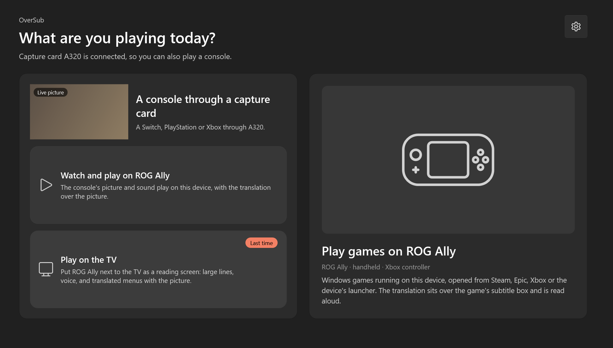
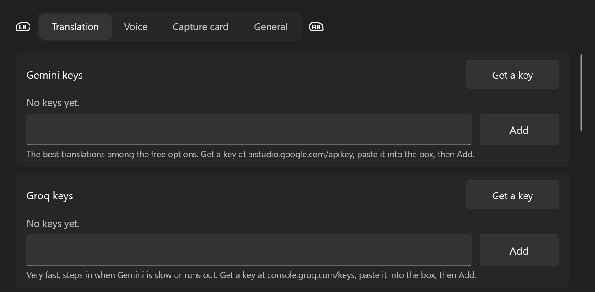
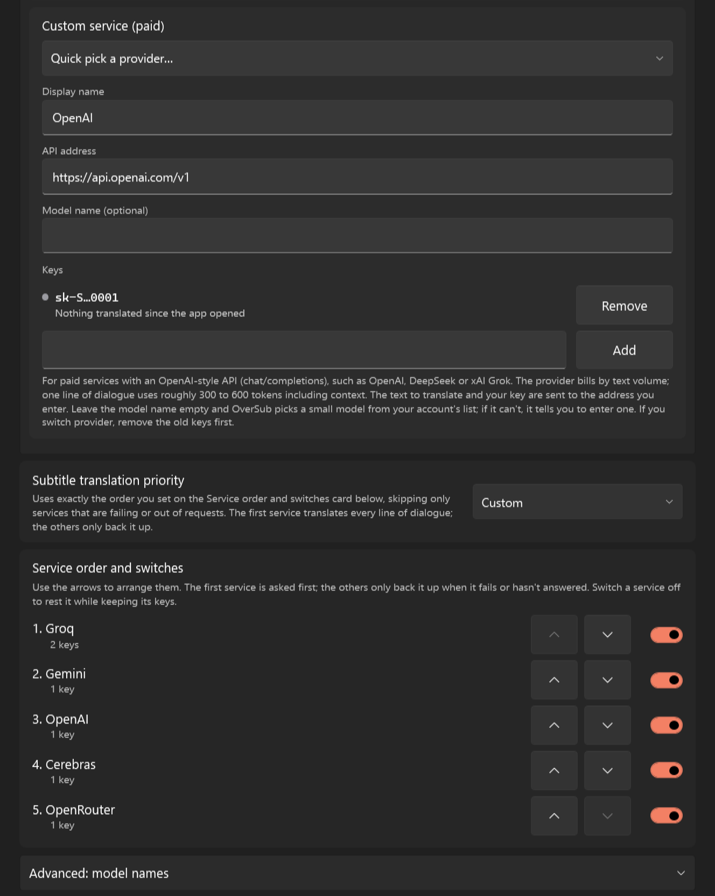

<div align="center">


# OverSub for Windows

Vietnamese subtitles, voice and screen translation for games on your Windows PC, with a controller, touch, keyboard or mouse.

OverSub reads the text in a game on screen, translates it with AI, shows the translation on top of the original text and reads the dialogue aloud in a Vietnamese voice. It works with Windows games running on the PC and with consoles (Switch, PlayStation, Xbox) through a capture card.

[](https://github.com/imhillxtz/oversub-windows/releases)


[Tiếng Việt](README.md) · English



<sub>The play mode screen when a capture card is connected. The device name and picture change to match your PC.</sub>

</div>

This repository holds only the installer and the documentation. The source code of OverSub for Windows is not published.

OverSub for Windows is in testing: releases are marked Pre-release and may still have bugs.

## Table of contents

- [What OverSub does](#what-oversub-does)
- [Three ways to play](#three-ways-to-play)
- [Requirements](#requirements)
- [Installing](#installing)
- [Getting started in 5 minutes](#getting-started-in-5-minutes)
- [Detailed guide](#detailed-guide)
- [Translation services and API keys](#translation-services-and-api-keys)
- [Controller, touch and keyboard](#controller-touch-and-keyboard)
- [Privacy and data](#privacy-and-data)
- [Troubleshooting and FAQ](#troubleshooting-and-faq)
- [Current limitations](#current-limitations)
- [Feedback and bug reports](#feedback-and-bug-reports)
- [Support](#support)
- [Other platforms](#other-platforms)
- [License](#license)

## What OverSub does

OverSub works with Windows games running directly on a desktop PC, laptop, touch 2-in-1 or handheld gaming PC, and with consoles (Switch, PlayStation, Xbox) connected through a capture card. The app never touches game files; it only reads the picture on screen or from the capture card.

| Feature | What it does |
|---|---|
| Subtitles | Reads the dialogue in the region you select, translates it and shows the translation over the game's subtitle box, matching the original background color, text color, font size and alignment. You can also view it in Floating subtitles, a separate subtitle strip above the game that you can drag anywhere. |
| Voice | Reads the translated dialogue aloud with the VieNeu Vietnamese voice running on your PC. Dialogue is read before interface text. The on-screen subtitle stays visible until the voice finishes speaking that line. |
| Screen translation | Translates text outside the dialogue in place, such as menus, quest logs, item descriptions and in-game tutorial pages. The app erases the original text by reconstructing the background from surrounding pixels and places the translated text in the same color inside the box. |

Other features:

- Three ways to play for different setups: play Windows games right on this PC, watch and play a console through a capture card on this screen, or place the PC next to the TV as a large-print reading screen with voice output.
- Subtitles on an LG TV: when playing on the TV, OverSub can send each translated dialogue line to an LG TV (webOS) on the same Wi-Fi network as a notification at the bottom of the TV screen.
- Text only mode on the TV reading screen: shows translated text from Screen translation regions in large print like dialogue and reads it aloud when you sit far from the screen.
- Per-game genre and forms of address: pick a genre (medieval, wuxia, anime, everyday and others) so the AI chooses a fitting tone and Vietnamese pronouns. OverSub learns and keeps each character's form of self-address across the session, or lets you pick each character's pronouns by hand.
- Keep proper names: automatically recognizes character names, place names and skill names from dialogue so they aren't translated into literal Vietnamese meanings, along with a proper-name list you can add to or remove from.
- Subtitle filter per game: by default every sentence and passage is translated and only button labels are skipped; you can include button labels or filter more strictly.
- Per-game translation memory: each game stores its own translated lines, dialogue context, forms of address and Screen translation interface text. Lines or menu items seen again appear right away without using AI requests.
- Dialogue history: look back at recent lines and hear them again, pin proper names from a line, or ignore fixed on-screen text (logos, interface labels) so it is never translated or read again.
- Reads 10 in-game languages: English, Japanese, Korean, Chinese (Simplified and Traditional), French, German, Spanish, Portuguese, Italian and Russian. Translates into 12 languages; languages other than Vietnamese use the built-in Windows voices.
- Full control with a controller, touch, keyboard only, or keyboard and mouse. Interface in Vietnamese and English.

## Three ways to play

Each time it opens, OverSub asks "What are you playing today?" with the option you used last time already selected. The device name and illustration on the selection screen change automatically to match the PC you are using. You can switch at any time with Change how you play in the main window.

### Play games on this PC

For Windows games opened from Steam, Epic, Xbox, Armoury Crate, Playnite or any other launcher on the PC. Press Start, then open your game; the translation appears over the game's subtitle box and the Vietnamese voice reads the dialogue aloud. OverSub reads only while a game window is in front, ignoring the Windows desktop and game launchers. When you switch to another game, the app switches to that game's saved regions, language and genre. While playing, hold View and press another button (or use the Ctrl Alt keyboard shortcuts) to select regions, replay a line, pause or bring OverSub back.

### Watch and play through a capture card

For connecting a console (Switch, PlayStation, Xbox) to your Windows PC through a capture card so you can watch the video, hear the game audio and read translations on this screen. You can watch in the preview area or select Full screen (double-tapping the picture also opens full screen).

In full screen, OverSub renders the picture at 60 frames per second with Direct3D and provides picture presets under Settings → Capture card: Original (no extra processing, lowest latency), Sharp (light sharpening with AMD FSR 1 RCAS), Smooth edges (FXAA anti-aliasing followed by RCAS sharpening) or Custom, along with Color range, Color matrix and HDR-to-SDR conversion. The added GPU latency is measured on your own PC and shown next to each option.

### Play on the TV

For when your console outputs to a TV through an HDMI splitter and capture card while your Windows PC sits beside the couch as a secondary reading screen. When you select Reading mode (or start translating in this mode), the window switches to the dark Reading view: dialogue lines appear in large text from 70% to 300% of the base size, the Vietnamese voice reads the dialogue aloud, and the lower area shows live cropped views of your Screen translation regions translated into Vietnamese. Tap the screen, move the mouse or press View to bring up the control bar for replaying, opening history, turning on Text only, changing text size and dimming the screen.

If your TV is an LG TV running webOS on the same Wi-Fi network as your Windows PC, you can also turn on Show subtitles on an LG TV under Settings → General. Turn on the TV, select Pair TV and choose Accept on the TV screen; use Send a test to verify right away. While in Reading view, each translated dialogue line appears as a toast notification at the bottom of the TV screen even while the TV is showing the console's HDMI port. Each notification stays for about 4.5 seconds; lines longer than one row are split into short parts marked with ellipses at the break and shown one after another.

## Requirements

- Windows 11 on an x64 PC: a desktop, laptop, 2-in-1 or handheld gaming PC. Windows 10 version 2004 or later can install it, but it hasn't been tested there.
- A Gemini or Groq API key for translation. Both have free tiers; see [Translation services and API keys](#translation-services-and-api-keys).
- The VieNeu Vietnamese voice is installed right inside the app, needing an internet connection once and about 1.5 GB of free space during installation; see [Vietnamese voice](#vietnamese-voice). Until it is installed, OverSub temporarily speaks with the built-in Windows Vietnamese voice if your PC has one, or shows text only.
- The two capture card modes need a webcam-class (UVC) capture card with a 1080p MJPEG stream. OverSub has been tested with a Hagibis capture card.
- The Windows text recognition pack for the game's language. English is usually installed already; for other languages the app prompts you to install it under Settings → Time & language → Language & region. On Windows 11, if Snipping Tool is installed, OverSub automatically uses Snipping Tool's text reader (OneOCR) to read small text more accurately.

The installer includes .NET, so you don't need to install .NET separately.

## Installing

1. Go to [Releases](https://github.com/imhillxtz/oversub-windows/releases) and download `OverSub-Setup-x.y.z.exe` under Assets.
2. Open the downloaded file. The installer isn't digitally signed yet, so Windows SmartScreen shows "Windows protected your PC". Click More info, check that the file name is `OverSub-Setup-x.y.z.exe`, then click Run anyway. If Windows is set to Vietnamese, these buttons appear in Vietnamese in the same place. Your browser may also say the file isn't commonly downloaded; choose Keep.
3. Follow the installer steps (the installer interface is in Vietnamese and English, chosen automatically from your Windows language). OverSub installs for your Windows account into `%LOCALAPPDATA%\Programs\OverSub`, needs no administrator rights, and adds a Start menu shortcut. If you open OverSub a second time while it is already running (for example from Armoury Crate and from the Start menu), the running window comes to the front and the second copy exits so two copies don't fight over the capture card and the voice.

### Verifying the SHA-256 checksum

You can verify that the downloaded file is the official build using the SHA-256 checksum included with each release. Open PowerShell in the folder containing the downloaded file and run:

```powershell
Get-FileHash .\OverSub-Setup-x.y.z.exe -Algorithm SHA256
```

Compare the result with the contents of `OverSub-Setup-x.y.z.exe.sha256` on the Releases page.

### Updating

OverSub checks the Releases page of this repository for a new version by itself. When a new version is available, a banner appears in the main window with a View button. Select View to open a window listing the changes from every release since the version you are using, with Update, Later and Skip this version buttons. When you select Update, the app downloads the installer, verifies the author's digital signature, and runs the installer silently; OverSub then closes and reopens on its own. Your settings, keys, game profiles, translation memory and installed voice are all kept.

Under Settings → General, you can turn the Check for new versions automatically switch on or off (on by default), turn on Install a new version when OverSub closes (off by default; when turned on, the new version is downloaded ahead of time and installed when you close the app), or select Check for updates at any time.

You can still download a new installer from the Releases page and run it over your current installation (click Watch → Custom → Releases at the top of this repository if you want notifications from GitHub). Versions 0.10.18 and earlier do not have automatic updates yet, so you need to download and install the new version by hand once for later versions to update automatically.

## Getting started in 5 minutes

The first time you open OverSub on a new PC, it opens the 4-step First-run guide: pick the game's usual language and the language to translate into, add a translation key (with Open the key page, Paste, Add and the Use Google Translate while there is no key checkbox), install the Vietnamese voice, and review how to select the subtitle region. Move through the steps with Next, Back, Skip the guide or Start using OverSub at the final step (on a controller: Menu for next, B for back). You can reopen it anytime under Settings → General → First-run guide → Open the guide.

1. Add a translation key: select Open the key page in the first-run guide (or Get a key under Settings → Translation) to get a free key at [Google AI Studio](https://aistudio.google.com/apikey) or [Groq](https://console.groq.com/keys). Copy the key, paste it into Gemini keys or Groq keys (the first-run guide has a Paste button too), select Add, then select Save.
2. Install the voice: go to Settings → Voice and select Install voice at the top of the page. Once installed, the voice turns on automatically.
3. Choose how you play: on the opening screen, choose Play games on this PC, Watch and play on this PC, or Play on the TV.
4. Choose the game's language and genre: in the Current game card on the main window, select Change to pick the in-game text language (English, Japanese, Korean, Chinese and others) and the genre that fits the game's setting (Automatic by default on a new PC; PCs upgrading from an older version keep their existing choice).
5. Select the subtitle region: open the game to a scene with dialogue. If playing through a capture card, select Select regions in the main window; if playing a game on this PC, select Start, switch to the game, then hold View and press X (or press Ctrl Alt R). Drag the white box around the game's dialogue box (including the speaker name tag if there is one) and select Save regions.
6. Select Start (if not already running) and turn Subtitles, Voice or Screen translation on or off right in the main window as needed.

## Detailed guide

### Selecting regions

The region editor lets you select the subtitle region and Screen translation regions at the same time. The white-bordered box is the Subtitle region (there is always one, wrapping the area where dialogue and speaker name tags appear). The sky-blue boxes are Screen translation regions (wrapping menus, quest boards or item descriptions; add and remove them freely).

- With a mouse or touch: drag inside a box to move it, drag any of the four corners to resize it, or drag across empty space to redraw the selected box. Tap or click any box to select it. The bottom bar has Add screen region, Remove this region, Remove all screen regions, Cancel and Save regions.
- With a controller: use the left stick or D-pad to move, the right stick to resize, LB or RB to switch between regions, Y to add a screen region, X to remove the selected region (hold X to remove all screen regions), A to save and B to cancel. When selecting regions directly over a game running on the PC, please hold View while pressing A, B, X, Y, LB or RB so the button presses don't go into the game.

### Subtitle region filter

By default OverSub translates every sentence and passage in the subtitle region, including item pickup lines and explanations with no speaker name; only button labels and short menu names are skipped. You can change this per game with Subtitle region filter in the Current game panel (opened with Change next to the game name):

- Translate every sentence (default): translates every sentence and passage, and skips button labels and short menu names.
- Include button labels: nothing is filtered; button labels and menu names are translated and read aloud too.
- Strict filter: also skips lines that look like system notices, such as item pickups. Some lines may be missed.

### On-game subtitles and Floating subtitles

When playing a game on the PC or in Watch and play mode through a capture card, the translation appears by default right over the original text inside the subtitle region. OverSub samples the background color beneath the original text as a solid fill to cover it cleanly, and matches the text color, alignment (left, center, right) and font size of the game. While the voice is turned on, the subtitle overlay keeps the line currently being spoken on screen until the voice finishes that line before moving to the next; if the previous line has finished speaking and the app is waiting for the AI to translate a new line, the old text dims slightly so you know a new line is about to appear.

If you prefer not to cover the original dialogue box or want subtitles in a fixed, easier-to-read spot, turn on Floating subtitles in the main window (or hold View and press LT, or press Ctrl Alt J in the game). Floating subtitles appear in a separate strip above the game that is excluded from screen capture so it is never read again.

- Tap or hover over the Floating subtitles strip to show the small button bar on the right and the four corner handles: drag the strip to move it, drag a corner horizontally to change the width, or drag a corner vertically to change the font size. The buttons on the strip switch between One line and Multiple lines, cycle the background (dark, dim, or clear with text shadow), decrease or increase the font size (A−, A+) and close the strip.
- With a controller: hold View and press RT in the game (or select Adjust floating on the full-screen control bar) to enter controller adjustment mode. Use the left stick and D-pad to move, the right stick to change the width, LB and RB to change the text size, X to switch between one line and multiple lines, Y to change the background, A to save and B to cancel.

### Vietnamese voice

The Vietnamese voice uses [VieNeu-TTS](https://github.com/pnnbao97/VieNeu-TTS) (Apache 2.0 license), running locally on your PC and installed directly inside OverSub without installing Python by hand or typing commands:

- Open Settings → Voice (or step 3 of the First-run guide), and in the voice block at the top of the page select Install voice. The app downloads its own Python runtime (about 11 MB from python.org), installs the required packages with pip from pypi.org and downloads the voice model from huggingface.co.
- The progress bar shows each installation step. Use Cancel to stop (already downloaded parts are kept, and installing again resumes from where it left off); if a network error occurs, the app shows the reason with a Retry button. Closing the Settings window doesn't stop the installation.
- The Nano model (default) downloads about 0.4 GB once, takes about 0.5 GB on disk and needs about 1.5 GB of free space during installation. Once installed, the voice turns on automatically without restarting the app. If a slow connection makes the voice load longer than usual, the app turns it on automatically when it finishes.
- Everything is kept in its own `%LOCALAPPDATA%\OverSub\voice` folder and doesn't touch any other Python installation or packages on your PC. To remove it, select Remove voice in the same block (press twice to confirm) to delete that folder.
- When the VieNeu voice isn't installed yet (or isn't ready yet), OverSub temporarily speaks with the built-in Windows Vietnamese voice if your PC has one (for example Microsoft An) and notes this in the main window; if your PC has no Windows Vietnamese voice, it shows text only. Once VieNeu is ready, the app switches to VieNeu automatically.

On the Voice tab in Settings, you can adjust:

- VieNeu model: Nano (fast, speaks after about 1.5 seconds, default) or Turbo (more natural, waits about 2 to 4 seconds per line). The Turbo model needs an extra 0.6 GB download via the Download Turbo button when Turbo is selected under VieNeu model (or Download Nano if the Nano model needs to be downloaded). Each model has several male and female voices to choose from under Voice, with a Preview button. If you switch between Nano and Turbo, please click Save to load the new model and reopen Settings to preview it.
- Voice output: set to Automatic by default, which plays through the default Windows speaker while skipping capture card audio ports and virtual speakers such as Steam Streaming so sound isn't lost. You can also pick a specific speaker or headset from the list.
- Voice volume: slide from 0% to 200%.
- When translating into a language other than Vietnamese, OverSub automatically switches to the built-in Windows voice for that language.

### Screen translation and Text only mode

Screen translation translates text on the game interface such as menus, skill trees, item lists or notifications. You can turn on the Screen translation switch in the main window, press RB on the viewer control bar, or hold View and press RB (or press Ctrl Alt T) right inside the game.

When running over a game or in Watch and play mode, each text cluster inside the region is erased over a background reconstructed from surrounding pixels and replaced with translated text of the same color, automatically sized to fit the box. Under Settings → Translation, Screen translation speed has three levels:

- Instant: uses Google Translate only, appearing after about 0.3 seconds without using AI requests.
- Instant, then refined by AI (default): shows the Google Translate version right away, then replaces it with a more natural AI translation 1 to 2 seconds later.
- Wait for AI: shows only the AI translation so wording and game terms are natural from the start.

Interface text items that have been translated once are remembered so the next time you open the menu, the AI translation appears right away.

When playing in Play on the TV mode (Reading view), Screen translation regions appear by default as live cropped pictures in the lower half of the screen with translations overlaid on the picture. If your Windows PC sits a bit far from your seat so small text in the cropped pictures is hard to read, open the Reading view control bar (tap the screen or press View) and turn on Text only (or hold View and press RB). In Text only mode:

- The cropped region pictures are hidden; sentence-like items in your Screen translation regions appear in large print right inside the dialogue card and are read aloud in Vietnamese.
- Dialogue subtitles always come first: if a character speaks, the dialogue line takes back the screen and the voice right away; once the dialogue finishes speaking or clears, the Screen translation text returns.
- When you move to another menu item or close the menu, the voice automatically stops reading the previous item's description so it doesn't keep speaking text that has disappeared. Items already read within the last 5 minutes are also not read again when you move the cursor back and forth.

### In-game tutorial pages

Many games have tutorial popups with a title at the top, one or more explanation paragraphs spanning multiple lines in the middle, and button labels (such as Close or Next) at the bottom. Translating each line separately like a regular menu breaks sentences apart and loses context.

In Text only mode of Reading view, when a Screen translation region covers a tutorial page, OverSub joins sentences that were split across a button icon (such as "Hold [button] to turn on…") into a complete sentence, and reads the page title before the body text.

### Forms of address and proper names

In Vietnamese, how a character refers to themself and addresses the listener strongly shapes the feel of every line. In the Current game card on the main window, select Change next to the game name to pick a Genre for that game (Automatic, Medieval Europe, Historical East Asia / Wuxia, Mythology / Epic, Anime / JRPG, Sci-fi / Cyberpunk, Modern / Everyday, School / Coming of age, Horror / Survival and several others). The genre guides the AI in choosing fitting pronouns and tone.

Alongside the genre, OverSub keeps lines consistent across dialogue through the following mechanisms:

- Learning and locking in forms of address per character: once a named character has referred to themself with a Vietnamese first-person pronoun (such as tôi, ta, tớ, tao, tui, or em, anh, chị, mình when the source line clearly identifies the first person), OverSub remembers that pronoun along with the matching listener pronoun for that character throughout later lines. When two characters are speaking back and forth, the app sends both sides' forms of address so replies call the listener by the right word. If the AI drifts from an established pronoun, the app automatically requests a retranslation. The app also strips trailing listener pronouns that the AI adds at the end of a sentence when the original line didn't address anyone.
- Choosing forms of address by hand: in the Current game panel (opened with the Change button next to the game name), select Characters to open the list of characters met so far. Each character has a Speaks as box and a Calls the player box for picking a fixed pronoun (such as tôi, ta, tớ, mình, em, anh, chị), and a Reset button so OverSub learns that character's forms of address again from scratch.
- Keeping proper names: character names, place names, monsters and special terms are kept as in the original, even when a menu item in Screen translation consists of a single proper name. If the AI accidentally translates away a proper name present in the source line, the app requests a retranslation. You can view and manage the proper-name list in the History window on the Proper names tab.

### Per-game translation memory

Each game in OverSub has a completely separate profile and translation memory:

- Playing a game on this PC: OverSub automatically detects the game in front and switches to that game's profile and memory.
- Playing through a capture card: the PC can't tell which game disc or cartridge the console is running, so you pick or add the game in the Current game panel (select Change next to the game name, then pick a game from the list or select Add a game…).

In the Current game panel, the Memory section for this game shows the number of dialogue lines, characters with learned pronouns and interface text items stored for the open game. If you change the game's genre or want to retranslate the entire game from scratch without touching other games, select Clear memory for this game and confirm. If you want to clear the memory of all games at once, go to Settings → Translation → Translation memory and select Clear all games….

### Japanese, Korean and Chinese games

OverSub reads and translates directly from games in Japanese, Korean, Simplified Chinese and Traditional Chinese:

- On Windows 11 with Snipping Tool installed, OverSub uses Snipping Tool's OneOCR text reader to read Japanese, Korean and Chinese text without needing an extra Windows text recognition pack. If the PC doesn't have Snipping Tool, the app prompts you to add that language under Settings → Time & language → Language & region.
- When joining multiple lines of a dialogue box, OverSub connects them without inserting extra spaces between characters and separates the character name when it stands on its own line above the dialogue.
- If a returned translation still contains untranslated source characters, OverSub tries the next key or service instead of showing and reading that untranslated text.

This has been tested so far with dialogue subtitles where the speaker name stands on its own line; Screen translation, Traditional Chinese and speaker names written on the same line as the dialogue haven't been tested yet.

### Dialogue history

Select History in the main window (or on the control bar in Watch and play or Reading view) to open the History window. The window has three tabs that you can switch with a mouse, touch or LB and RB on a controller:

- Dialogue history: lists recently translated lines from newest to oldest. On each line, you can select Replay (A on a controller) to hear the line again, Keep a name… (Y) to quickly pick a capitalized word in the line or type a proper name to keep unchanged, or Ignore this line (X) if it is fixed on-screen text that you don't want translated anymore.
- Ignored lines: lists the dialogue lines and Screen translation items you have chosen to ignore in the current game. Select Translate again on a row to remove it from the list and translate it again as usual.
- Proper names: lists the proper names kept unchanged during translation. You can type a new name into the box and select Add, remove individual names, or select Clear all.

## Translation services and API keys

To translate with AI, you need at least one Gemini or Groq API key. You can add a key right in step 2 of the First-run guide (select Open the key page, then use Paste and Add, or turn on Use Google Translate while there is no key) or add one in Settings. Both services offer free plans:

1. Open OverSub, select Settings and choose the Translation tab.
2. Select Get a key on the Gemini or Groq card to open your browser to the free key page at [Google AI Studio](https://aistudio.google.com/apikey) (Gemini) or [Groq](https://console.groq.com/keys).
3. Paste the key into Gemini keys or Groq keys and select Add. You can add multiple keys. The app test-translates a short line to check the key and adds it only if it works.
4. Select Save.



| Service | Notes |
|---|---|
| Gemini | Produces the most natural translations and keeps tone best among the free options. Free quota is counted per Google Cloud project, so multiple keys created in the same project share one quota; to increase your quota, create keys in separate projects. |
| Groq | Very fast. Steps in right away when Gemini is busy, takes longer than 2.5 seconds to answer or runs out of quota. |
| Cerebras | As fast as Groq. The free plan counts quota in words per day. |
| Mistral | A generous free quota but only one request per second, so it suits a backup role. |
| OpenRouter | One key for many models. Free models have names ending in :free and are limited in requests per day. |
| Custom service (paid) | A service with an OpenAI-style API (chat/completions), such as OpenAI, DeepSeek or xAI Grok. The provider bills by text volume; one line of dialogue uses roughly 300 to 600 tokens including context. |
| Google Translate (fallback) | No key needed. When you have no key yet, OverSub translates with Google Translate and the status line in the main window states clearly that there is no translation key so Google Translate is in use. When Show a Google Translate version while waiting for AI is turned on, if the AI version hasn't arrived after 1.5 seconds, the line temporarily shows Google Translate and is replaced by the AI version once ready (the voice still reads only the AI version). When all AI services fail or run out of quota, OverSub uses Google Translate so play isn't interrupted. |

You should add both Gemini and Groq keys so they back each other up. Under Settings → Translation, the More translation services (optional) section, open by default, lets you add keys for Cerebras, Mistral and OpenRouter (all with free tiers, each with its own Get a key button, key box and Add button) as extra backups when both Gemini and Groq run out of quota. At the end of that section, the Custom service (paid) card has a Quick pick a provider list that fills in the name and API address for OpenAI, DeepSeek, xAI (Grok), Together AI or Fireworks, or you can type the API address of any other service with an OpenAI-style API (the address starts with https://), then paste the key and select Add. The Model name box can stay empty: OverSub picks a small model from your account's list, and asks you to enter a name if it can't. The saved key list shows a colored dot and a status line for each key: active with the number of lines translated today, paused after running out of quota with the time it can be used again, or the most recent error.

Under Subtitle translation priority, you can choose:

- Prefer quality (default): uses one primary service throughout (preferring Gemini) to keep tone and forms of address consistent between lines; Groq steps in only when the primary service fails or takes longer than 2.5 seconds.
- Balanced: balances translation quality against the actual latency measured on your PC.
- Prefer speed: always puts the fastest-responding service first.
- Custom: uses exactly the order you set on the Service order and switches card, skipping only services that are failing or out of requests. The first service translates every line of dialogue; the others only back it up.

The Service order and switches card sits right below Subtitle translation priority. It lists the services that have a key, each with a switch to rest it while keeping its keys; with Custom selected, each row also gets two arrows to move the service up or down. The Advanced: model names section lets you set a model name of your own for Gemini, Groq, Cerebras, Mistral and OpenRouter, for example a paid OpenRouter model; leave a box empty and OverSub chooses.



Free quotas are set by each provider and may change over time. The fees of a custom service are charged by its provider at their own prices.

### Getting a free key

Both services below have a free tier and both need an account. The app keeps your keys only on your PC (encrypted for your Windows account) and sends the text to translate only to the services you added a key for.

**Gemini (Google AI Studio, recommended)**

1. Select Get a key on the Gemini card (Settings → Translation, or the Open the key page button in the First-run guide), or open [aistudio.google.com/apikey](https://aistudio.google.com/apikey).
2. Sign in with a Google account. The first time, accept the Google AI Studio terms; according to Google's documentation, a new account gets a default project and key created for it.
3. On the API Keys page, copy an existing key or select Create API key to make a new one.
4. Back in OverSub, paste the key into Gemini keys, select Add, then select Save.

If the page won't let you create a key (it says "You do not have permission to create a key in this project") or you have no project, an existing Google Cloud account usually has no default project yet. Open the Dashboard in the left panel, choose Projects, select Import projects, pick a project, then go back to the API Keys page and create the key.

Gemini's free quota is counted per Google Cloud project, not per key, so several keys in the same project share one quota. Limits differ between models, change over time and are not guaranteed by Google; daily limits reset at midnight Pacific time. See your current limits on the rate limit page in Google AI Studio. If the Google page shows a key as Blocked (keys that go unused for long are blocked), create a new key.

**Groq**

1. Select Get a key on the Groq card, or open [console.groq.com/keys](https://console.groq.com/keys).
2. Sign in or create a Groq account if the page asks you to. If the account belongs to a team, only the team owner or a member with the developer role can create keys.
3. Select Create API Key, follow the steps on the page, then copy the key.
4. Back in OverSub, paste the key into Groq keys, select Add, then select Save.

Groq limits usage per model (requests and tokens per minute and per day), and the free plan has different limits from the Developer plan. See your account's current limits on the Limits page after signing in.

**Keep your key secret**

Treat a key like a password: don't post it online or paste it into screenshots or public files. Anyone who has it can use up your quota. If you think a key has leaked, create a new key on the Google or Groq page, delete the old one there, then select Remove next to the old key under Settings → Translation in OverSub and add the new key.

## Controller, touch and keyboard

Windows PCs come in many form factors: desktops, laptops, 2-in-1 tablets and handheld gaming PCs. Every screen in OverSub can be controlled completely with a controller, touch, keyboard only, or keyboard and mouse, and you can switch between them at any time. OverSub updates the button hints at the bottom of the screen to match whichever input device you touched last.

| Input method | In OverSub |
|---|---|
| Controller | Every screen can be navigated with the D-pad or left stick, selecting with A and going back with B; LB and RB switch tabs in Settings and History. In a game, hold View and press another button. |
| Touch | Buttons are at least 48 points tall for easy finger taps. Drag region boxes and the Floating subtitles strip with your finger, double-tap the capture card picture to go full screen, tap once on the reading or viewer screen to show the control bar. The touch keyboard appears automatically when you tap a key or game-name box and hides when you finish. |
| Keyboard only | Tab, the arrow keys and Enter move through every button; Ctrl Tab (or Ctrl Page Down, Ctrl Page Up) switches tabs in Settings; Esc closes dialogs or exits full screen. In a game, use the Ctrl Alt shortcuts. |
| Keyboard and mouse | Moving the mouse or typing hides the controller button icons and switches the in-game control list to show Ctrl Alt shortcuts; pressing a button on the controller switches the interface back right away. |

### Controls while playing a game on this PC

When playing a game running directly on your Windows PC, regular button presses go into the game, so OverSub uses the View button (the two-squares button on Xbox-style controllers) held down together with another button. If you hold View a little longer in the game, a button reminder overlay appears in the top-left corner of the screen. Without a controller, use the corresponding Ctrl Alt keyboard shortcuts.

| Action | Controller (hold View, then press) | Keyboard |
|---|---|---|
| Select the subtitle and screen regions | X | Ctrl Alt R |
| Replay the last line | Y | Ctrl Alt Space |
| Pause or resume | B | Ctrl Alt P |
| Hide or show the translation | A | Ctrl Alt H |
| Turn Screen translation on or off | RB | Ctrl Alt T |
| Turn Floating subtitles on or off | LT | Ctrl Alt J |
| Adjust position, width and font size of Floating subtitles | RT | |
| Ignore the current line from now on | LB | |
| Open the OverSub window | Menu | Ctrl Alt O |

When in full-screen Watch and play mode or in Reading view next to the TV, the controller on the Windows PC isn't controlling the character in the game, so you can press buttons directly or open the control bar with View without holding View for every action.

### Xbox Full Screen Experience and Steam Input

If your handheld or PC has the Xbox Full Screen Experience turned on, Windows sends regular controller input only to the app in front (the game). OverSub reads the controller through Windows GameInput, so holding View still reaches OverSub while you play in full screen.

Screens of the Xbox app, Armoury Crate, Steam, Playnite and other game launchers are recognized so OverSub doesn't misread text on a launcher; the app starts reading only once you are inside a game. If Steam Input converts controller buttons into keyboard keys under its desktop layout when outside a game, OverSub also translates those keys back into controller buttons on its own screens.

## Privacy and data

Screenshots and video streams from the capture card are processed entirely on your PC and are never sent anywhere. Text recognition (OneOCR and Windows OCR) and the VieNeu Vietnamese voice both run right on your PC. When you select Install voice, the app downloads its own Python runtime, packages and voice model from python.org, pypi.org and huggingface.co (connecting only during installation, without sending any of your data out).

When translating, only the recognized text is sent to the translation service:

- The AI services you added keys for (Gemini, Groq, Cerebras, Mistral, OpenRouter or a custom service) receive the line to translate, a few previous lines for context, the forms of address of related characters and the game's genre. For a custom service, this content and your key are sent to the API address you entered.
- Google Translate receives text when showing a temporary translation while waiting for AI or when using Instant mode in Screen translation. If you don't want text sent to Google Translate, go to Settings → Translation, turn off Show a Google Translate version while waiting for AI, and set Screen translation speed to Wait for AI.

OverSub has no server of its own, collects no usage data and has no ads. Update checks only query the public Releases page of this repository on GitHub without sending any user information; a downloaded installer is run only if it carries a valid digital signature from the author. Bug report packages are created on your PC only when you press the button and are never sent automatically. All local data on your PC is stored in `%LOCALAPPDATA%\OverSub`:

- `keys.bin`: holds the API keys you entered, encrypted by Windows with DPAPI for your specific Windows user account (keys are never written to logs or shown in full on screen).
- `lgtv.bin`: holds pairing information for your LG TV (if you use TV subtitles), also encrypted with DPAPI for your Windows account.
- `settings.json`, `ui-memory.json` and translation memory files: store settings, per-game region profiles, forms of address and translated lines.
- `voice`: holds the private Python runtime and VieNeu voice models, removable with the Remove voice button under Settings → Voice.
- `Logs`: holds per-session diagnostic logs. Logs include text read from the game and translations to help troubleshoot bugs, but never contain API keys.
- `Reports`: holds `.zip` bug report packages created with Send a bug report… (keeps the 5 most recent packages).

## Troubleshooting and FAQ

<details>
<summary>Windows SmartScreen or my browser blocks the installer from opening</summary>

The installer doesn't have a paid code-signing certificate yet, so Windows SmartScreen shows the "Windows protected your PC" dialog the first time you open it. Please click More info, check that the file name is `OverSub-Setup-x.y.z.exe` downloaded from the Releases page of this repository, and click Run anyway. If Windows is set to Vietnamese, these buttons appear in Vietnamese in the same place. If your browser reports that the file is rarely downloaded, click the three-dots menu next to the download and choose Keep. You can also verify the SHA-256 checksum as described under [Installing](#installing).
</details>

<details>
<summary>The Vietnamese voice doesn't start, or reports that it is running with no sound</summary>

- Open Settings → Voice and check the status line in the voice installation block at the top of the page. If it isn't installed yet, select Install voice; if a previous installation was interrupted by a network error, the status line shows the reason and you can select Retry to continue installing.
- During the first 7 seconds after opening OverSub, or on the first run when downloading the model over a slow connection, the VieNeu voice is still loading so the app temporarily speaks with the Windows Vietnamese voice (if your PC has one) or shows text only. If loading takes longer than usual, the app turns the voice on automatically when it finishes, without needing a restart. You can select Preview under Settings → Voice to check.
- If the app reports that it is playing the voice but you hear nothing, Windows may have switched its default speaker to the capture card's audio port or a virtual speaker when you plugged in the capture card. Go to Settings → Voice → Voice output, choose your PC's speaker or the headphones you are wearing, and select Save.
</details>

<details>
<summary>The app doesn't translate, shows only Google Translate, or translates slowly</summary>

- Open Settings → Translation to check the status of each key. The status line tells you whether the key is active, paused after hitting a per-minute or daily limit, or shows the specific error if the key is invalid.
- Gemini's free quota is counted by Google across an entire Google Cloud project. If you create multiple keys inside the same project, once one key runs out of quota the remaining keys in that project run out too. You should add a Groq key as well so the two services can back each other up.
</details>

<details>
<summary>The app can't read text in the game, or misreads many words</summary>

- Select Select regions (or hold View and press X in the game) and adjust the white Subtitle region box so it wraps the game's dialogue box snugly, including the speaker name tag. Avoid dragging the box so wide that it includes surrounding scenery.
- Open the Current game panel (the Change button next to the game name in the main window) and check that the game language matches the language displayed in the game (for example, if the game displays Japanese text, choose Japanese).
- When playing games in Japanese, Korean, Chinese or other non-English languages and the PC reports a missing text recognition pack, open Windows Settings → Time & language → Language & region and click Add a language to install that language pack.
- On Windows 11, install or update Snipping Tool from the Microsoft Store and leave Text reader under Settings → General set to Automatic, prefer OneOCR. Snipping Tool's OneOCR reads small game text much more accurately than Windows OCR.
</details>

<details>
<summary>The capture card shows no picture, or colors look washed out or grey</summary>

- Check that the capture card is plugged into a USB 3.0 port and the console is turned on and outputting at 1080p. If another program (such as OBS or the Camera app) is holding the capture card, please close that program and reselect the card in OverSub.
- If the picture from the capture card looks washed out with blacks turning grey, or overly dark with crushed shadow detail, open Settings → Capture card and switch Color range between Automatic, Limited (16 to 235) and Full (0 to 255).
- If the console has HDR turned on and the picture through the capture card looks grey and dull, go to Settings → Capture card → HDR and choose Tone-map HDR to SDR, or turn off HDR Output in the console's settings.
</details>

<details>
<summary>Controller button presses in the game aren't recognized by OverSub</summary>

- While playing a game on the PC, you need to hold View first and then press the action button (for example, hold View and press X to select regions). Holding View for about half a second brings up the button reminder overlay in the top-left corner of the screen.
- If you use button-remapping software from your device maker (such as Armoury Crate, Handheld Companion or Steam Input) and have assigned the View button to another key, the native View button signal may no longer be sent. Please keep the default function of the View button or use the Ctrl Alt keyboard shortcuts.
</details>

<details>
<summary>How to uninstall and remove all data</summary>

Go to Windows Settings → Apps → Installed apps, find OverSub and click Uninstall. The uninstaller asks whether to also delete the `%LOCALAPPDATA%\OverSub` data folder (holding settings, encrypted keys, game profiles, translation memory, the voice installed in `voice` and logs); the default choice is No so your data is kept if you install again later. When running a silent command-line uninstall, data is always kept unless you pass `/DELETEDATA=1`. The voice installed inside the app lives in the `voice` folder and can be removed on its own with Remove voice under Settings → Voice, or deleted along with the data folder. You can also delete the folder by hand: open File Explorer, paste `%LOCALAPPDATA%\OverSub` into the address bar and delete that folder. If you previously installed Python 3.12 and the `vieneu` package yourself for an older version, uninstall them separately in Installed apps.
</details>

## Current limitations

- The installer isn't digitally signed yet, so Windows SmartScreen warns on first launch.
- There is no native build for Windows PCs with ARM chips yet.
- Versions 0.10.18 and earlier do not have automatic updates yet, so you need to download and install the new version by hand once to get automatic updates.
- The Vietnamese voice requires downloading about 0.4 GB on first installation. During the first 7 seconds after opening the app, while the voice is loading its model, dialogue lines may show text only without being read aloud by VieNeu yet.
- When playing a game running directly on the PC in legacy Exclusive Fullscreen mode (used by some older DirectX 9 or DirectX 11 games), Windows overlay windows may not be able to appear on top of the game; please switch the display mode in the game's settings to Borderless Windowed or Windowed.
- Japanese, Korean and Chinese games have been tested so far with dialogue subtitles; Screen translation and Traditional Chinese haven't been tested yet.
- This build has been tested thoroughly on a ROG Ally handheld with a Hagibis capture card. If OverSub doesn't run properly on your PC or device, please report it in an Issue.

## Feedback and bug reports

The quickest way is to open Settings → General (which shows the version line `OverSub x.y.z`) and select Send a bug report…. The app creates a `.zip` package on your PC in `%LOCALAPPDATA%\OverSub\Reports` (keeping the 5 most recent packages, with logs, settings and PC information; no API keys, TV pairing data or translation memory) and opens a window with three buttons: Show the file, Open the issue page (opens a new GitHub Issue with your version and PC details prefilled) and Send by email (starts an email to `hillx.design@gmail.com`). The app never sends anything on its own; drag the `.zip` file onto the issue page or attach it to the email yourself.

You can also open an [Issue](https://github.com/imhillxtz/oversub-windows/issues) on GitHub directly with your OverSub version, the Windows PC model you use, the game title and how you play, and attach the latest log file from `%LOCALAPPDATA%\OverSub\Logs` (open it quickly with the Open folder button under Settings → General → Diagnostic log). Please read through the log before sending it, as the log contains lines of text read from your game.

## Support

OverSub is free for everyone. It was made so that anyone playing games can follow the story, even when the game isn't in their language. If you find it useful, you can buy me a coffee to support its development. Every contribution, large or small, helps fund bug fixes, support for more games and new features.


- International: [paypal.me/ngochieuit](https://paypal.me/ngochieuit).
- In Vietnam: scan the VietQR code with a banking app, MoMo or ZaloPay (recipient TRINH NGOC HIEU, MoMo wallet, message "OverSub").
- Starring this repository or recommending OverSub to a friend is another way to help.

<br clear="right">

## Other platforms

If you play games on a Mac (Apple Silicon), see the macOS version at [imhillxtz/oversub-mac](https://github.com/imhillxtz/oversub-mac).

## License

© 2026 imhillxtz. All rights reserved.

OverSub is free to use but is not open-source software, and the source code of the Windows version is not published. Redistributing the installer, modifying the program or reverse engineering it requires written permission from the author. See [LICENSE](LICENSE) for details.

The installer includes the .NET runtime and several open-source libraries under their own licenses, listed in `THIRD-PARTY-NOTICES.txt` in the installation folder. Game titles and trademarks mentioned belong to their respective owners. OverSub uses services from Google and Groq under each provider's terms.
