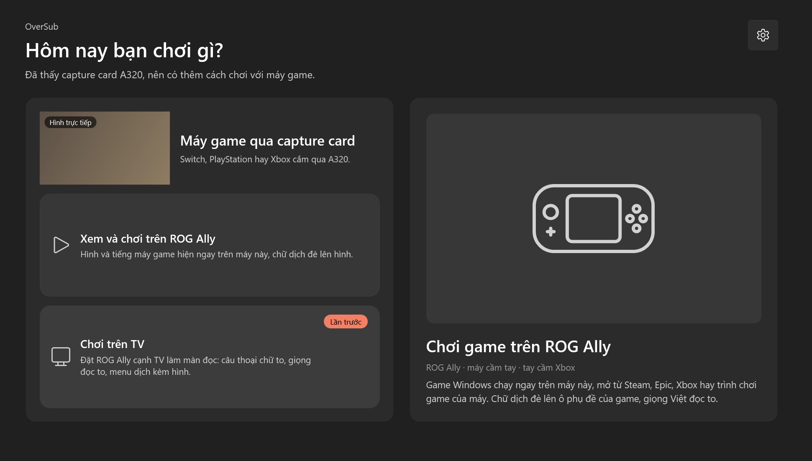
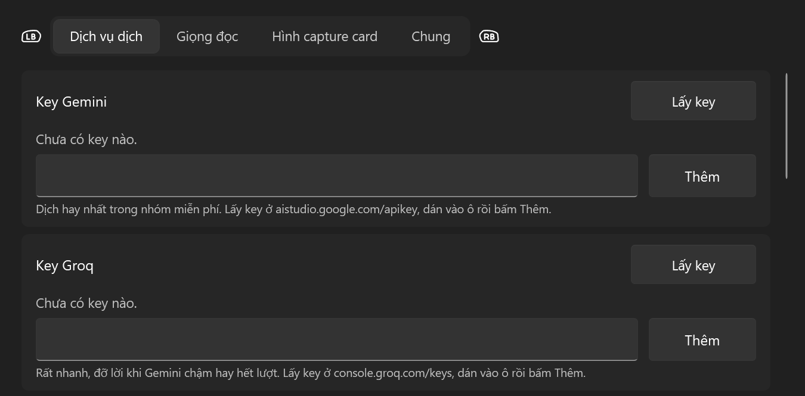
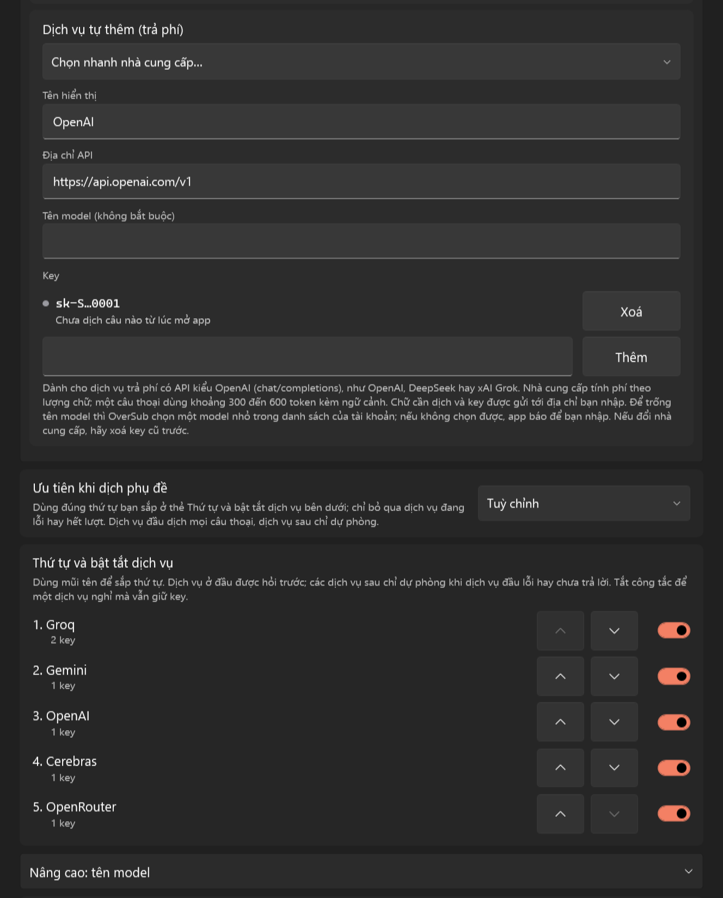

<div align="center">


# OverSub cho Windows

Phụ đề tiếng Việt, giọng đọc và dịch màn hình cho game trên máy Windows của bạn, dùng tay cầm, cảm ứng, bàn phím hay chuột đều được.

OverSub đọc chữ trong game trên màn hình, dịch bằng AI rồi hiện bản dịch đè lên chỗ chữ gốc và đọc to lời thoại bằng giọng Việt. App dùng được với game Windows chạy trên máy và với máy console (Switch, PlayStation, Xbox) qua capture card.

[](https://github.com/imhillxtz/oversub-windows/releases)


Tiếng Việt · [English](README.en.md)



<sub>Màn chọn cách chơi khi có capture card. Tên và hình máy đổi theo máy bạn đang dùng.</sub>

</div>

https://github.com/user-attachments/assets/53a41568-c7d5-4734-913f-22f9ba1ecebc

<sub>Video giới thiệu OverSub cho Windows.</sub>

Kho này chỉ chứa bộ cài và tài liệu. Mã nguồn của OverSub cho Windows không được công khai.

OverSub cho Windows đang ở giai đoạn thử nghiệm: các bản phát hành được gắn nhãn Pre-release và có thể còn lỗi.

## Mục lục

- [OverSub làm được gì](#oversub-làm-được-gì)
- [Ba cách chơi](#ba-cách-chơi)
- [Yêu cầu](#yêu-cầu)
- [Cài đặt](#cài-đặt)
- [Bắt đầu trong 5 phút](#bắt-đầu-trong-5-phút)
- [Hướng dẫn chi tiết](#hướng-dẫn-chi-tiết)
- [Dịch vụ dịch và key API](#dịch-vụ-dịch-và-key-api)
- [Tay cầm, cảm ứng và bàn phím](#tay-cầm-cảm-ứng-và-bàn-phím)
- [Quyền riêng tư và dữ liệu](#quyền-riêng-tư-và-dữ-liệu)
- [Câu hỏi thường gặp và xử lý sự cố](#câu-hỏi-thường-gặp-và-xử-lý-sự-cố)
- [Giới hạn hiện tại](#giới-hạn-hiện-tại)
- [Góp ý và báo lỗi](#góp-ý-và-báo-lỗi)
- [Ủng hộ](#ủng-hộ)
- [Nền tảng khác](#nền-tảng-khác)
- [Bản quyền](#bản-quyền)

## OverSub làm được gì

OverSub dùng được với game Windows chạy trực tiếp trên PC để bàn, laptop, máy 2 trong 1 cảm ứng hay máy chơi game cầm tay, và với máy console (Switch, PlayStation, Xbox) cắm qua capture card. App không can thiệp vào tệp của game mà chỉ đọc hình ảnh trên màn hình hoặc từ capture card.

| Tính năng | Làm gì |
|---|---|
| Phụ đề | Đọc lời thoại trong vùng bạn chọn, dịch rồi hiện bản dịch đè lên ô phụ đề của game theo màu nền, màu chữ, cỡ chữ và căn lề của hộp thoại gốc. Có thể xem ở Phụ đề nổi, một dải phụ đề riêng nằm trên game và kéo đi đâu cũng được. |
| Giọng đọc | Đọc to lời thoại đã dịch bằng giọng Việt VieNeu chạy ngay trên máy. Câu thoại được ưu tiên đọc trước chữ giao diện. Lớp chữ dịch trên màn hình giữ câu đang đọc cho tới khi giọng đọc xong. |
| Dịch màn hình | Dịch tại chỗ chữ ngoài lời thoại như menu, bảng nhiệm vụ, mô tả vật phẩm và các trang hướng dẫn trong game. App xoá chữ gốc bằng cách dựng lại nền từ các điểm ảnh xung quanh rồi đặt chữ dịch cùng màu vào đúng khung. |

Các tính năng khác:

- Ba cách chơi cho từng hoàn cảnh: chơi game Windows ngay trên máy, xem và chơi máy console qua capture card trên màn hình máy, hoặc đặt máy cạnh TV làm màn đọc chữ to và phát giọng đọc.
- Phụ đề trên TV LG: khi chơi trên TV, OverSub có thể gửi mỗi câu thoại đã dịch lên TV LG (webOS) cùng mạng Wi-Fi thành thông báo nổi ở cuối màn hình TV.
- Chế độ Chỉ chữ ở màn đọc cạnh TV: hiện chữ dịch của vùng Dịch màn hình bằng chữ to như phụ đề và đọc to thành tiếng cho lúc ngồi xa màn hình.
- Thể loại và xưng hô theo từng game: chọn thể loại (trung cổ, kiếm hiệp, anime, đời thường...) để AI chọn giọng văn và cách xưng hô phù hợp. OverSub tự học và giữ nguyên cách từng nhân vật tự xưng qua suốt buổi chơi, hoặc cho bạn chọn tay cách xưng của từng nhân vật.
- Giữ nguyên tên riêng: tự nhận tên nhân vật, địa danh, chiêu thức từ lời thoại để không dịch sang nghĩa tiếng Việt, kèm danh sách tên riêng cho bạn tự thêm hoặc xoá.
- Lọc vùng phụ đề theo từng game: mặc định dịch mọi câu và đoạn, chỉ bỏ nhãn nút; có thể dịch cả nhãn nút hoặc lọc chặt hơn.
- Trí nhớ bản dịch theo từng game: mỗi game lưu riêng câu thoại đã dịch, ngữ cảnh hội thoại, xưng hô và chữ giao diện của Dịch màn hình. Câu hoặc mục menu gặp lại sẽ hiện ngay mà không tốn lượt gọi AI.
- Lịch sử thoại: xem lại và nghe đọc lại các câu vừa qua, ghim tên riêng từ câu thoại, hoặc bỏ qua những dòng chữ cố định trên màn hình (logo, nhãn giao diện) để từ đó không dịch và không đọc nữa.
- Đọc được 10 ngôn ngữ trong game: tiếng Anh, Nhật, Hàn, Trung (giản thể và phồn thể), Pháp, Đức, Tây Ban Nha, Bồ Đào Nha, Ý và Nga. Dịch sang 12 ngôn ngữ; các ngôn ngữ khác tiếng Việt dùng giọng đọc có sẵn của Windows.
- Điều khiển trọn vẹn bằng tay cầm, cảm ứng, chỉ bàn phím, hoặc bàn phím và chuột. Giao diện có tiếng Việt và tiếng Anh.

## Ba cách chơi

Mỗi lần mở, OverSub hỏi "Hôm nay bạn chơi gì?" và chọn sẵn cách bạn dùng lần trước. Tên và hình minh hoạ trên màn chọn tự đổi theo máy bạn đang dùng. Bạn có thể đổi lại bất cứ lúc nào bằng nút Đổi cách chơi ở cửa sổ chính.

### Chơi game trên máy này

Dành cho game Windows mở từ Steam, Epic, Xbox, Armoury Crate, Playnite hay bất kỳ trình chơi game nào trên máy. Bạn bấm Bắt đầu rồi mở game; bản dịch sẽ đè lên ô phụ đề của game và giọng Việt đọc to lời thoại. OverSub chỉ đọc khi cửa sổ game ở phía trước, không đọc màn hình nền Windows hay các trình quản lý game. Khi đổi sang game khác, app tự chuyển sang hồ sơ vùng chọn, ngôn ngữ và thể loại của game đó. Trong lúc chơi, giữ nút View rồi bấm thêm một nút (hoặc bấm phím tắt Ctrl Alt) để chọn vùng, đọc lại, tạm dừng hay mở lại OverSub.

### Xem và chơi qua capture card

Dành cho lúc bạn cắm máy console (Switch, PlayStation, Xbox) vào máy Windows qua capture card để vừa xem hình, vừa nghe tiếng game và đọc bản dịch ngay trên màn hình này. Bạn có thể xem trong khung xem trước hoặc bấm Toàn màn hình (chạm hai lần vào hình cũng mở toàn màn hình).

Ở chế độ toàn màn hình, OverSub vẽ hình bằng Direct3D ở 60 khung hình/giây và cung cấp bộ chỉnh hình trong Cài đặt → Hình capture card: Gốc (không xử lý thêm, độ trễ thấp nhất), Nét (làm nét nhẹ bằng RCAS của AMD FSR 1), Mịn cạnh (khử răng cưa FXAA rồi làm nét RCAS) hoặc Tuỳ chỉnh, kèm chỉnh Dải màu, Chuẩn màu và chuyển đổi HDR về SDR. Độ trễ GPU cộng thêm được đo trên chính máy của bạn và ghi rõ cạnh từng lựa chọn.

### Chơi trên TV

Dành cho lúc máy console xuất hình ra TV qua bộ chia HDMI và capture card, còn máy Windows đặt cạnh ghế sofa làm màn đọc phụ. Khi bấm Chế độ đọc (hoặc khi bắt đầu dịch ở cách chơi này), cửa sổ chuyển sang màn Đang đọc nền tối: câu thoại hiện bằng chữ lớn từ 70% đến 300% cỡ gốc, giọng Việt đọc to lời thoại, phần dưới hiện hình trực tiếp của các vùng Dịch màn hình đã dịch sang tiếng Việt. Chạm vào màn hình, rê chuột hoặc bấm nút View sẽ hiện thanh nút điều khiển để đọc lại, mở lịch sử, bật Chỉ chữ, chỉnh cỡ chữ và giảm độ sáng màn hình.

Nếu TV của bạn là TV LG chạy webOS và nối cùng mạng Wi-Fi với máy Windows, bạn có thể bật thêm Hiện phụ đề trên TV LG ở Cài đặt → Chung. Bật TV, bấm Ghép nối TV rồi chọn Đồng ý trên màn hình TV; có nút Gửi thử để kiểm tra ngay. Khi đang ở màn Đang đọc, mỗi câu thoại dịch xong sẽ hiện thành thông báo nổi ở cuối màn hình TV ngay cả khi TV đang chiếu cổng HDMI của máy game. Mỗi thông báo đứng khoảng 4,5 giây; câu dài hơn một dòng được chia thành các đoạn ngắn kèm dấu ba chấm ở chỗ ngắt để hiện nối tiếp nhau.

## Yêu cầu

- Windows 11 trên máy x64: PC để bàn, laptop, máy 2 trong 1 hay máy chơi game cầm tay. Windows 10 bản 2004 trở lên cài được nhưng chưa được thử.
- Key API của Gemini hoặc Groq để dịch. Cả hai đều có gói miễn phí, xem mục [Dịch vụ dịch và key API](#dịch-vụ-dịch-và-key-api).
- Giọng đọc tiếng Việt VieNeu cài ngay trong app, cần mạng một lần và khoảng 1,5 GB dung lượng trống lúc cài; xem mục [Giọng đọc tiếng Việt](#giọng-đọc-tiếng-việt). Khi chưa cài, OverSub tạm đọc bằng giọng tiếng Việt của Windows nếu máy có, không thì chỉ hiện chữ.
- Hai cách chơi qua capture card cần một capture card kiểu webcam (UVC) có luồng MJPEG 1080p. OverSub được thử với capture card Hagibis.
- Gói đọc chữ của Windows cho ngôn ngữ trong game. Tiếng Anh thường có sẵn; với ngôn ngữ khác, app sẽ nhắc cài ở Settings → Time & language → Language & region. Trên Windows 11, nếu máy có Snipping Tool, OverSub tự dùng bộ đọc chữ của Snipping Tool (OneOCR) để đọc chính xác hơn với chữ nhỏ.

Bộ cài đã kèm .NET, nên không cần cài .NET riêng.

## Cài đặt

1. Vào trang [Releases](https://github.com/imhillxtz/oversub-windows/releases), tải tệp `OverSub-Setup-x.y.z.exe` ở mục Assets.
2. Mở tệp vừa tải. Bộ cài chưa có chữ ký số nên Windows SmartScreen sẽ hiện "Windows protected your PC". Bấm More info, kiểm tra tên tệp là `OverSub-Setup-x.y.z.exe`, rồi bấm Run anyway. Nếu Windows của bạn dùng tiếng Việt, các nút này hiện bằng tiếng Việt, ở cùng vị trí. Trình duyệt cũng có thể báo tệp "không thường được tải về"; chọn Giữ lại (Keep).
3. Làm theo các bước của bộ cài (giao diện có tiếng Việt và tiếng Anh, tự chọn theo ngôn ngữ Windows). OverSub được cài cho tài khoản Windows của bạn vào `%LOCALAPPDATA%\Programs\OverSub`, không cần quyền quản trị, và có lối tắt trong Start menu. Khi mở OverSub lần hai trong lúc app đang chạy (ví dụ mở từ Armoury Crate và từ Start menu), cửa sổ đang chạy sẽ hiện lên và bản thứ hai tự thoát để hai bản không tranh capture card và giọng đọc.

### Kiểm tra mã SHA-256

Bạn có thể kiểm tra tệp tải về đúng là bản chính thức bằng mã SHA-256 đi kèm mỗi bản phát hành. Mở PowerShell tại thư mục chứa tệp tải về và chạy:

```powershell
Get-FileHash .\OverSub-Setup-x.y.z.exe -Algorithm SHA256
```

So kết quả với nội dung tệp `OverSub-Setup-x.y.z.exe.sha256` trên trang Releases.

### Cập nhật

OverSub tự kiểm tra bản mới trên trang Releases của kho này. Khi có bản mới, cửa sổ chính hiện thông báo nổi kèm nút Xem. Bấm Xem để mở cửa sổ liệt kê thay đổi của mọi bản kể từ bản bạn đang dùng, với ba nút Cập nhật, Để sau và Bỏ qua bản này. Khi chọn Cập nhật, app tải bộ cài về, kiểm tra chữ ký số của tác giả rồi chạy bộ cài im lặng; xong xuôi OverSub tự đóng rồi mở lại. Cài đặt, key, hồ sơ game, trí nhớ dịch và giọng đọc đều giữ nguyên.

Ở Cài đặt → Chung, bạn có thể bật hoặc tắt công tắc Tự kiểm tra bản mới (mặc định bật), bật công tắc Cài bản mới khi thoát OverSub (mặc định tắt; khi bật, bản mới tải sẵn rồi cài lúc bạn thoát app) hoặc bấm Kiểm tra cập nhật bất cứ lúc nào.

Bạn vẫn có thể tự tải bộ cài mới trên trang Releases và chạy đè lên bản đang có (bấm Watch → Custom → Releases ở đầu trang kho này nếu muốn nhận thông báo từ GitHub). Các bản từ 0.10.18 trở về trước chưa có tự cập nhật, nên cần tải và cài bản mới bằng tay một lần để những bản sau tự cập nhật.

## Bắt đầu trong 5 phút

Lần mở đầu tiên trên máy mới, OverSub mở cửa sổ Hướng dẫn lần đầu gồm 4 bước: chọn Game thường dùng tiếng và Dịch sang, thêm key dịch (có nút Mở trang lấy key, Dán, Thêm và ô Dùng Google Dịch khi chưa có key), cài giọng đọc tiếng Việt, và xem cách chọn vùng phụ đề. Bạn chuyển bước bằng nút Tiếp, Quay lại, Bỏ qua hướng dẫn hoặc Bắt đầu dùng ở bước cuối (trên tay cầm: Menu sang bước tiếp, B quay lại). Có thể mở lại bất cứ lúc nào ở Cài đặt → Chung → Hướng dẫn lần đầu → Mở hướng dẫn.

1. Thêm key dịch: bấm Mở trang lấy key trong hướng dẫn lần đầu (hoặc nút Lấy key ở Cài đặt → Dịch vụ dịch) để lấy key miễn phí tại [Google AI Studio](https://aistudio.google.com/apikey) hoặc [Groq](https://console.groq.com/keys). Sao chép key, dán vào ô Key Gemini hoặc Key Groq (ở hướng dẫn lần đầu có thêm nút Dán), bấm Thêm rồi bấm Lưu.
2. Cài giọng đọc: vào Cài đặt → Giọng đọc, bấm Cài giọng đọc ở đầu trang. Cài xong giọng tự bật.
3. Chọn cách chơi: ở màn hình mở đầu, chọn Chơi game trên máy này, Xem và chơi trên máy này hoặc Chơi trên TV.
4. Chọn ngôn ngữ và thể loại game: ở thẻ Game đang chơi trên cửa sổ chính, bấm Đổi để chọn ngôn ngữ chữ trong game (tiếng Anh, Nhật, Hàn, Trung...) và thể loại phù hợp với bối cảnh game (mặc định trên máy mới là Tự động; máy nâng cấp từ bản cũ giữ nguyên thể loại đã chọn).
5. Chọn vùng phụ đề: mở game tới đoạn có lời thoại. Nếu chơi qua capture card, bấm Chọn vùng trên cửa sổ chính; nếu chơi game trên máy, bấm Bắt đầu, vào game rồi giữ View và bấm X (hoặc bấm Ctrl Alt R). Kéo khung trắng bao quanh hộp thoại của game (bao cả nhãn tên nhân vật nếu có) rồi bấm Lưu vùng.
6. Bấm Bắt đầu (nếu chưa chạy) và bật hoặc tắt Phụ đề, Giọng đọc, Dịch màn hình ngay trên cửa sổ chính tuỳ nhu cầu.

## Hướng dẫn chi tiết

### Chọn vùng

Trình chọn vùng cho phép chọn cùng lúc vùng phụ đề và các vùng Dịch màn hình. Khung viền trắng là Vùng phụ đề (luôn có một vùng, ôm trọn chỗ lời thoại và nhãn tên nhân vật hiện ra). Các khung viền xanh da trời là vùng Dịch màn hình (ôm menu, bảng nhiệm vụ hay ô mô tả vật phẩm; thêm và xoá tuỳ ý).

- Dùng chuột hoặc cảm ứng: kéo bên trong khung để dời chỗ, kéo bốn góc để đổi cỡ, hoặc kéo trên vùng trống để vẽ lại khung đang chọn. Chạm hoặc bấm vào khung nào để chọn khung đó. Thanh nút bên dưới có Thêm vùng dịch màn hình, Xoá vùng này, Xoá mọi vùng dịch, Huỷ và Lưu vùng.
- Dùng tay cầm: gạt cần trái hoặc bấm D-pad để di chuyển, gạt cần phải để đổi cỡ, bấm LB hoặc RB để đổi giữa các vùng, bấm Y để thêm vùng dịch màn hình, bấm X để xoá vùng đang chọn (giữ X lâu để xoá mọi vùng dịch màn hình), bấm A để lưu và B để huỷ. Khi chọn vùng ngay trên game đang chạy trên máy, vui lòng giữ nút View trong lúc bấm các nút A, B, X, Y, LB, RB để nút bấm không lọt vào game.

### Lọc vùng phụ đề

Mặc định OverSub dịch mọi câu và đoạn trong vùng phụ đề, gồm cả câu nhận vật phẩm và lời giải thích không có tên người nói; chỉ nhãn nút và tên mục ngắn được bỏ qua. Ô Lọc vùng phụ đề trong bảng Game đang chơi (mở bằng nút Đổi cạnh tên game) đổi được mức này cho từng game:

- Dịch mọi câu (mặc định): dịch mọi câu và đoạn, bỏ qua nhãn nút và tên mục ngắn.
- Dịch cả nhãn nút: không lọc gì, nhãn nút và tên mục cũng được dịch và đọc to.
- Lọc chặt: bỏ thêm những câu giống thông báo hệ thống, như câu nhận vật phẩm. Có thể bỏ sót câu.

### Phụ đề trên game và Phụ đề nổi

Khi chơi game trên máy hoặc ở chế độ Xem và chơi qua capture card, bản dịch mặc định hiện đè lên đúng vị trí chữ gốc trong vùng phụ đề. OverSub tự lấy màu nền dưới chữ gốc làm nền đặc để che kín chữ gốc, lấy màu chữ, căn lề (trái, giữa, phải) và cỡ chữ tương đương với chữ của game. Khi giọng đọc đang bật, lớp chữ dịch giữ câu đang được đọc trên màn hình cho tới khi giọng đọc dứt câu rồi mới chuyển sang câu kế; nếu câu cũ đã đọc xong và đang chờ AI dịch câu mới, chữ cũ sẽ mờ đi một chút để bạn biết câu mới sắp hiện.

Nếu không muốn đè lên hộp thoại gốc hoặc muốn đặt phụ đề ở vị trí cố định dễ nhìn hơn, hãy bật Phụ đề nổi trên cửa sổ chính (hoặc giữ View bấm LT, hay bấm Ctrl Alt J trong game). Phụ đề nổi là một dải chữ riêng nằm trên game, loại trừ khỏi ảnh chụp màn hình nên không bao giờ bị đọc lặp lại.

- Chạm hoặc rê chuột vào dải Phụ đề nổi để hiện thanh nút nhỏ ở góc phải và bốn ô kéo ở bốn góc: kéo dải để dời vị trí, kéo ngang góc để đổi bề rộng, kéo dọc góc để đổi cỡ chữ. Các nút trên dải gồm chuyển giữa chế độ Một dòng và Nhiều dòng, đổi nền (tối, mờ, trong suốt có bóng chữ), giảm hoặc tăng cỡ chữ (A−, A+) và đóng dải.
- Dùng tay cầm: giữ View rồi bấm RT trong game (hoặc bấm nút Chỉnh phụ đề nổi trên thanh nút toàn màn hình) để vào chế độ chỉnh bằng tay cầm. Khi đó dùng cần trái và D-pad để dời chỗ, cần phải để đổi bề rộng, LB và RB để đổi cỡ chữ, X để đổi một dòng hay nhiều dòng, Y để đổi nền, A để lưu và B để huỷ.

### Giọng đọc tiếng Việt

Giọng Việt dùng [VieNeu-TTS](https://github.com/pnnbao97/VieNeu-TTS) (giấy phép Apache 2.0), chạy ngay trên máy và cài trực tiếp trong OverSub mà không cần tự cài Python hay gõ lệnh:

- Mở Cài đặt → Giọng đọc (hoặc ở bước 3 của Hướng dẫn lần đầu), tại khối cài giọng ở đầu trang bấm Cài giọng đọc. App tự tải bản Python riêng (khoảng 11 MB từ python.org), cài thư viện bằng pip từ pypi.org rồi tải model giọng từ huggingface.co.
- Thanh tiến độ hiện các bước cài. Có nút Huỷ để dừng (phần đã tải được giữ lại, bấm cài lại sẽ làm tiếp); nếu lỗi mạng thì app báo lý do và có nút Thử lại. Đóng cửa sổ Cài đặt không dừng việc cài.
- Bộ giọng Nano (mặc định) tải khoảng 0,4 GB một lần, chiếm khoảng 0,5 GB trên ổ đĩa và cần còn trống khoảng 1,5 GB lúc cài. Cài xong giọng tự bật, không cần mở lại app. Nếu mạng chậm khiến giọng nạp lâu hơn thường, app tự bật giọng khi xong.
- Mọi thứ nằm trong thư mục riêng `%LOCALAPPDATA%\OverSub\voice`, không đụng tới Python hay gói nào khác trên máy. Để gỡ, bấm nút Gỡ giọng đọc trong cùng khối (bấm hai lần để xác nhận) để xoá thư mục này.
- Khi chưa cài giọng VieNeu (hoặc lúc giọng chưa lên), OverSub tạm đọc bằng giọng tiếng Việt của Windows nếu máy có (ví dụ Microsoft An) và báo trên cửa sổ chính; máy không có giọng tiếng Việt của Windows thì chỉ hiện chữ. Khi VieNeu sẵn sàng, app tự chuyển sang VieNeu.

Ở tab Giọng đọc trong Cài đặt, bạn có thể chỉnh:

- Bộ giọng VieNeu: Nano (nhanh, đọc sau khoảng 1,5 giây, mặc định) hoặc Turbo (tự nhiên hơn, chờ khoảng 2 đến 4 giây mỗi câu). Bộ Turbo cần tải thêm khoảng 0,6 GB bằng nút Tải bộ Turbo khi chọn Turbo ở ô Bộ giọng VieNeu (hoặc nút Tải bộ Nano nếu cần tải bộ Nano). Mỗi bộ có nhiều giọng nam và nữ để chọn ở mục Giọng, kèm nút Nghe thử. Nếu đổi giữa Nano và Turbo, vui lòng bấm Lưu để nạp bộ giọng mới rồi mở lại Cài đặt để nghe thử.
- Khi chạy pin, đọc bằng giọng Windows (mặc định bật): khi rút sạc, OverSub đọc bằng giọng tiếng Việt của Windows và tắt VieNeu, vì VieNeu tốn nhiều CPU lúc sinh câu (đo trên ROG Ally, game tụt khoảng 4 đến 8% FPS khi thoại dày) và giữ khoảng 900 MB RAM. Cắm sạc lại thì app nạp lại VieNeu, giọng Windows đọc tạm trong vài giây chờ.
- Loa phát giọng: mặc định để Tự chọn, app sẽ phát ra loa mặc định của Windows nhưng tự tránh cổng âm thanh của capture card và các loa ảo như Steam Streaming để không bị mất tiếng. Bạn cũng có thể chọn cố định một loa hoặc tai nghe trong danh sách.
- Âm lượng giọng đọc: kéo từ 0% đến 200%.
- Khi dịch sang ngôn ngữ khác tiếng Việt, OverSub tự chuyển sang giọng đọc có sẵn của Windows cho ngôn ngữ đó.

### Dịch màn hình và chế độ Chỉ chữ

Dịch màn hình dùng để dịch chữ trên giao diện game như menu, bảng kỹ năng, danh sách vật phẩm hay thông báo. Bạn có thể bật công tắc Dịch màn hình trên cửa sổ chính, bấm RB trên thanh nút của màn xem, hoặc giữ View bấm RB (phím tắt Ctrl Alt T) ngay trong game.

Khi chạy trên game hoặc trên màn Xem và chơi, từng cụm chữ trong vùng dịch được xoá trên nền đã dựng lại từ điểm ảnh xung quanh và thay bằng chữ dịch cùng màu, tự căn cỡ cho vừa khung. Ở Cài đặt → Dịch vụ dịch, mục Tốc độ Dịch màn hình có ba mức:

- Tức thì: chỉ dùng Google Dịch, hiện sau khoảng 0,3 giây và không tốn lượt gọi AI.
- Tức thì, rồi chuốt bằng AI (mặc định): hiện ngay bản Google Dịch rồi thay bằng bản dịch AI tự nhiên hơn sau 1 đến 2 giây.
- Chờ bản AI: chỉ hiện bản dịch AI để câu chữ tự nhiên và đúng thuật ngữ ngay từ đầu.

Những mục chữ giao diện đã dịch một lần sẽ được nhớ lại để lần sau mở lại menu là hiện ngay bản dịch AI.

Khi chơi ở chế độ Chơi trên TV (màn Đang đọc), mặc định các vùng Dịch màn hình hiện thành các khung hình trực tiếp ở nửa dưới màn hình với bản dịch đè lên hình. Nếu bạn đặt máy Windows hơi xa chỗ ngồi nên khó nhìn chữ nhỏ trong khung hình, hãy mở thanh nút của màn Đang đọc (chạm màn hình hoặc bấm View) rồi bật Chỉ chữ (hoặc giữ View bấm RB). Ở chế độ Chỉ chữ:

- Khung hình vùng dịch được ẩn đi; các mục chữ thành câu trong vùng Dịch màn hình sẽ hiện bằng chữ lớn ngay tại khung câu thoại và được giọng Việt đọc to.
- Phụ đề lời thoại luôn được ưu tiên: nếu có nhân vật nói chuyện, câu thoại sẽ lấy lại màn hình và giọng đọc ngay; khi thoại đọc xong hoặc tắt đi, chữ của vùng Dịch màn hình mới hiện lên.
- Khi bạn chuyển sang mục menu khác hoặc đóng menu, giọng đọc tự ngắt phần mô tả của mục cũ để không đọc lê thê chữ đã biến mất. Các mục đã đọc trong vòng 5 phút cũng không bị đọc lặp lại khi bạn di con trỏ qua lại.

### Trang hướng dẫn trong game

Nhiều game có các bảng hướng dẫn (tutorial) gồm một tiêu đề ở trên, một hoặc nhiều đoạn văn giải thích kéo dài qua nhiều dòng ở giữa và các nhãn nút bấm (như Đóng, Tiếp) ở dưới đáy. Nếu dịch rời từng dòng như menu thông thường, câu văn bị cắt vụn và mất ngữ cảnh.

Ở chế độ Chỉ chữ của màn Đang đọc, khi vùng Dịch màn hình bao quanh một trang hướng dẫn, OverSub ghép lại những câu bị biểu tượng nút bấm cắt ngang (kiểu "Giữ [nút] để bật chế độ…") thành một câu trọn vẹn, và đọc tiêu đề trang trước phần thân bài.

### Xưng hô và tên riêng

Trong tiếng Việt, cách nhân vật tự xưng và gọi người nghe quyết định rất lớn đến cảm xúc câu thoại. Ở thẻ Game đang chơi trên cửa sổ chính, bạn bấm nút Đổi cạnh tên game để chọn Thể loại cho riêng game đó (Tự động, Trung cổ châu Âu, Cổ trang / Kiếm hiệp, Thần thoại / Sử thi, Anime / JRPG, Khoa học viễn tưởng / Cyberpunk, Hiện đại / Đời thường, Học đường / Thanh xuân, Kinh dị / Sinh tồn và một số thể loại khác). Thể loại này định hướng cho AI chọn xưng hô (như ta với ngươi, tại hạ với các hạ, tớ với cậu) và văn phong phù hợp.

Bên cạnh thể loại, OverSub giữ sự nhất quán qua từng câu thoại bằng các cơ chế sau:

- Tự học và chốt xưng hô theo nhân vật: khi một nhân vật có tên đã tự xưng bằng một đại từ (như tôi, ta, tớ, tao, tui, hoặc em, anh, chị, mình khi câu gốc xác định rõ ngôi thứ nhất), OverSub ghi nhớ cách tự xưng đó cùng từ gọi người nghe tương ứng cho nhân vật này trong suốt các câu sau. Khi hai nhân vật đang đối thoại qua lại, app gửi kèm cách xưng của cả hai bên để câu đáp gọi đúng người đang nghe. Nếu AI dịch lệch khỏi cách tự xưng đã chốt, app tự yêu cầu dịch lại. App cũng tự lược bỏ các từ gọi người nghe mà AI tự thêm vào cuối câu khi câu gốc không hề gọi ai.
- Chọn xưng hô bằng tay: trong bảng Game đang chơi (mở bằng nút Đổi cạnh tên game), bấm Xưng hô để mở danh sách các nhân vật đã gặp. Mỗi nhân vật có ô Tự xưng và ô Gọi người chơi để chọn một cách cố định (như tôi, ta, tớ, mình, em, anh, chị), và nút Làm lại để OverSub học lại từ đầu cách xưng hô của nhân vật đó.
- Giữ nguyên tên riêng: tên nhân vật, địa danh, quái vật và thuật ngữ riêng được giữ nguyên như bản gốc, kể cả khi mục menu trong Dịch màn hình chỉ gồm một tên riêng. Nếu AI vô tình dịch mất tên riêng có trong câu gốc, app sẽ yêu cầu dịch lại. Bạn có thể xem và quản lý danh sách tên riêng ở cửa sổ Lịch sử → tab Tên riêng.

### Trí nhớ bản dịch theo từng game

Mỗi game trong OverSub có một hồ sơ và trí nhớ bản dịch hoàn toàn tách biệt:

- Chơi game trên máy: OverSub tự nhận diện game đang ở phía trước và chuyển sang hồ sơ cùng trí nhớ của game đó.
- Chơi qua capture card: máy tính không tự biết máy console đang chạy đĩa game nào, nên bạn chọn hoặc thêm game trong bảng Game đang chơi (nút Đổi cạnh tên game → chọn game trong danh sách hoặc bấm Thêm game…).

Trong bảng Game đang chơi, mục Trí nhớ của game này cho biết số câu thoại, số nhân vật đã nhớ xưng hô và số mục chữ giao diện đã lưu của riêng game đang mở. Nếu bạn đổi thể loại game hoặc muốn dịch lại toàn bộ game này từ đầu mà không chạm tới các game khác, hãy bấm Xoá trí nhớ của game này… rồi xác nhận. Nếu muốn xoá trí nhớ của tất cả các game cùng lúc, vào Cài đặt → Dịch vụ dịch → Trí nhớ bản dịch và bấm Xoá mọi game….

### Game tiếng Nhật, Hàn, Trung

OverSub hỗ trợ đọc chữ và dịch trực tiếp từ game tiếng Nhật, tiếng Hàn, tiếng Trung giản thể và tiếng Trung phồn thể:

- Trên Windows 11 có Snipping Tool, OverSub dùng bộ đọc chữ OneOCR của Snipping Tool để đọc chữ Nhật, Hàn, Trung mà không cần cài thêm gói đọc chữ của Windows. Nếu máy không có Snipping Tool, app sẽ nhắc bạn thêm ngôn ngữ đó ở Settings → Time & language → Language & region.
- Khi ghép nhiều dòng của hộp thoại, OverSub không chèn dấu cách thừa giữa các chữ và tách tên nhân vật đứng ở dòng riêng phía trên lời thoại.
- Nếu bản dịch trả về vẫn còn lẫn chữ gốc chưa dịch, OverSub thử key hay dịch vụ kế tiếp thay vì hiện và đọc phần chữ gốc đó.

Phần này mới được thử với phụ đề hội thoại có tên người nói ở dòng riêng; Dịch màn hình, tiếng Trung phồn thể và tên người nói viết cùng dòng với lời thoại chưa được thử.

### Lịch sử thoại

Bấm nút Lịch sử trên cửa sổ chính (hoặc trên thanh nút của màn Xem và chơi và màn Đang đọc) để mở cửa sổ Lịch sử. Cửa sổ có ba tab chuyển được bằng chuột, cảm ứng hoặc nút LB, RB trên tay cầm:

- Lịch sử thoại: liệt kê các câu vừa dịch từ mới nhất trở xuống. Ở mỗi câu, bạn có thể bấm Đọc lại (nút A trên tay cầm) để nghe lại câu đó, bấm Giữ nguyên tên… (nút Y) để chọn nhanh một từ viết hoa trong câu hoặc tự gõ tên riêng cần giữ nguyên, hoặc bấm Bỏ qua câu này (nút X) nếu đó là dòng chữ cố định trên màn hình mà bạn không muốn dịch nữa.
- Câu bỏ qua: danh sách các câu thoại và các mục Dịch màn hình bạn đã chọn bỏ qua ở game hiện tại. Bấm Dịch lại ở một dòng để gỡ nó khỏi danh sách và dịch lại như thường.
- Tên riêng: danh sách các tên riêng đang được giữ nguyên khi dịch. Bạn có thể gõ tên mới vào ô rồi bấm Thêm, xoá từng tên hoặc bấm Xoá hết.

## Dịch vụ dịch và key API

Để dịch bằng AI, bạn cần ít nhất một key API của Gemini hoặc Groq. Bạn có thể thêm key ngay ở bước 2 của Hướng dẫn lần đầu (bấm Mở trang lấy key, rồi dùng nút Dán và Thêm, hoặc bật ô Dùng Google Dịch khi chưa có key) hay thêm trong Cài đặt. Cả hai dịch vụ đều cung cấp gói miễn phí:

1. Mở OverSub, bấm Cài đặt, chọn tab Dịch vụ dịch.
2. Bấm nút Lấy key trên thẻ Gemini hoặc Groq để mở trình duyệt tới trang tạo key miễn phí ở [Google AI Studio](https://aistudio.google.com/apikey) (Gemini) hoặc [Groq](https://console.groq.com/keys).
3. Dán key vào ô Key Gemini hoặc Key Groq rồi bấm Thêm. Bạn có thể thêm nhiều key. App sẽ dịch thử một câu ngắn để kiểm tra và chỉ thêm khi key hoạt động.
4. Bấm Lưu.



| Dịch vụ | Ghi chú |
|---|---|
| Gemini | Dịch tự nhiên và giữ văn phong tốt nhất trong nhóm miễn phí. Hạn mức miễn phí tính theo dự án Google Cloud, nên nhiều key tạo trong cùng một dự án sẽ dùng chung hạn mức; muốn tăng hạn mức cần tạo key ở các dự án khác nhau. |
| Groq | Tốc độ phản hồi rất nhanh. Đóng vai trò dự phòng tức thì khi Gemini bận, trả lời chậm quá 2,5 giây hoặc hết lượt. |
| Cerebras | Nhanh ngang Groq. Gói miễn phí tính hạn mức theo số chữ mỗi ngày. |
| Mistral | Hạn mức miễn phí rộng nhưng chỉ một lượt mỗi giây, nên hợp làm dự phòng. |
| OpenRouter | Một key dùng được nhiều model. Model miễn phí có tên kết thúc bằng :free và bị giới hạn số lượt mỗi ngày. |
| Dịch vụ tự thêm (trả phí) | Dịch vụ có API kiểu OpenAI (chat/completions), như OpenAI, DeepSeek hay xAI Grok. Nhà cung cấp tính phí theo lượng chữ; một câu thoại dùng khoảng 300 đến 600 token kèm ngữ cảnh. |
| Google Dịch (tạm) | Không cần key. Khi chưa có key nào, OverSub dịch bằng Google Dịch và dòng trạng thái ở cửa sổ chính báo rõ "Chưa có key dịch nên đang dùng Google Dịch". Khi bật ô Hiện bản Google Dịch trong lúc chờ AI, nếu bản AI chưa về sau 1,5 giây thì câu thoại hiện tạm bản Google Dịch rồi tự thay bằng bản AI khi có (giọng đọc vẫn chỉ đọc bản AI). Khi mọi dịch vụ AI đều lỗi hoặc hết lượt, OverSub dùng bản Google Dịch để việc chơi không bị đứt quãng. |

Bạn nên thêm cả key Gemini và key Groq để dự phòng cho nhau. Ở Cài đặt → Dịch vụ dịch còn có khối Dịch vụ dịch khác (không bắt buộc), mở sẵn, để thêm key của Cerebras, Mistral và OpenRouter (đều có gói miễn phí, mỗi dịch vụ có nút Lấy key, ô nhập key và nút Thêm) làm dự phòng khi Gemini và Groq hết lượt. Cuối khối là thẻ Dịch vụ tự thêm (trả phí): bấm Chọn nhanh nhà cung cấp để điền sẵn tên và địa chỉ API của OpenAI, DeepSeek, xAI (Grok), Together AI hoặc Fireworks, hay tự nhập địa chỉ API của một dịch vụ khác có API kiểu OpenAI (địa chỉ bắt đầu bằng https://), rồi dán key và bấm Thêm. Ô Tên model có thể để trống: OverSub chọn một model nhỏ trong danh sách của tài khoản, và báo để bạn nhập tên nếu không chọn được. Danh sách key đã lưu có chấm màu và dòng trạng thái của từng key: đang hoạt động kèm số câu đã dịch hôm nay, tạm nghỉ vì hết lượt kèm lúc dùng lại được, hoặc lỗi lần gần nhất.

Ở mục Ưu tiên khi dịch phụ đề, bạn có thể chọn:

- Ưu tiên chất lượng (mặc định): dùng một dịch vụ chính xuyên suốt (ưu tiên Gemini) để giữ giọng văn và xưng hô đồng nhất giữa các câu; chỉ khi dịch vụ chính lỗi hoặc chậm quá 2,5 giây thì Groq mới đỡ lời.
- Cân bằng: cân đối giữa chất lượng bản dịch và độ trễ thực tế đo được trên máy.
- Ưu tiên tốc độ: luôn ưu tiên dịch vụ có thời gian phản hồi nhanh nhất.
- Tuỳ chỉnh: dùng đúng thứ tự bạn sắp ở thẻ Thứ tự và bật tắt dịch vụ; chỉ bỏ qua dịch vụ đang lỗi hoặc hết lượt. Dịch vụ đầu dịch mọi câu thoại, các dịch vụ sau chỉ dự phòng.

Thẻ Thứ tự và bật tắt dịch vụ nằm ngay dưới mục Ưu tiên. Thẻ liệt kê các dịch vụ đã có key, mỗi dịch vụ có một công tắc để cho nghỉ mà vẫn giữ key; khi chọn Tuỳ chỉnh, mỗi dòng có thêm hai mũi tên để đưa dịch vụ lên hoặc xuống. Khối Nâng cao: tên model cho phép đặt tên model riêng cho Gemini, Groq, Cerebras, Mistral và OpenRouter, ví dụ một model trả phí của OpenRouter; để trống thì OverSub tự chọn.



Hạn mức miễn phí do từng nhà cung cấp quy định và có thể thay đổi theo thời gian. Phí của dịch vụ tự thêm do nhà cung cấp tính theo bảng giá của họ.

### Lấy key miễn phí

Cả hai dịch vụ dưới đây có gói miễn phí và đều cần một tài khoản. App chỉ lưu key trên máy bạn (mã hoá theo tài khoản Windows) và gửi chữ cần dịch tới dịch vụ bạn đã thêm key.

**Gemini (Google AI Studio, khuyên dùng)**

1. Bấm Lấy key trên thẻ Gemini (Cài đặt → Dịch vụ dịch, hoặc nút Mở trang lấy key ở Hướng dẫn lần đầu), hay mở [aistudio.google.com/apikey](https://aistudio.google.com/apikey).
2. Đăng nhập bằng tài khoản Google. Lần đầu, hãy chấp nhận điều khoản của Google AI Studio; theo tài liệu của Google, tài khoản mới được tạo sẵn một dự án và một key mặc định.
3. Ở trang API Keys, chép key đã có hoặc bấm Create API key để tạo key mới.
4. Quay lại OverSub, dán key vào ô Key Gemini, bấm Thêm rồi bấm Lưu.

Nếu trang không cho tạo key (báo "You do not have permission to create a key in this project") hoặc bạn không có dự án nào, thường là do tài khoản Google Cloud có sẵn chưa có dự án mặc định. Mở Dashboard ở thanh bên trái, chọn Projects, bấm Import projects, chọn một dự án rồi quay lại trang API Keys để tạo key.

Hạn mức miễn phí của Gemini tính theo dự án Google Cloud, không theo key, nên nhiều key trong cùng một dự án dùng chung hạn mức. Hạn mức khác nhau giữa các model, đổi theo thời gian và Google không bảo đảm; hạn mức theo ngày đặt lại vào nửa đêm giờ Thái Bình Dương. Xem hạn mức hiện tại của bạn ở trang hạn mức (rate limit) trong Google AI Studio. Nếu trang Google ghi key ở trạng thái Blocked (key lâu không dùng bị chặn), hãy tạo key mới.

**Groq**

1. Bấm Lấy key trên thẻ Groq, hay mở [console.groq.com/keys](https://console.groq.com/keys).
2. Đăng nhập hoặc tạo tài khoản Groq nếu trang yêu cầu. Nếu tài khoản thuộc một nhóm, chỉ chủ nhóm hoặc thành viên có vai trò developer mới tạo được key.
3. Bấm Create API Key, làm theo các bước trên trang rồi chép key.
4. Quay lại OverSub, dán key vào ô Key Groq, bấm Thêm rồi bấm Lưu.

Groq giới hạn theo từng model (số yêu cầu và số token mỗi phút, mỗi ngày), và gói miễn phí có hạn mức khác gói Developer. Xem hạn mức hiện tại của tài khoản ở trang Limits sau khi đăng nhập.

**Giữ key bí mật**

Hãy coi key như mật khẩu: không đăng lên mạng xã hội, không dán vào ảnh chụp màn hình hay tệp công khai. Người khác có key sẽ dùng hết hạn mức của bạn. Nếu nghi key bị lộ, tạo key mới ở trang của Google hoặc Groq, xoá key cũ ở đó, rồi bấm Xoá cạnh key cũ trong Cài đặt → Dịch vụ dịch của OverSub và thêm key mới.

## Tay cầm, cảm ứng và bàn phím

Máy Windows có nhiều kiểu dáng: PC để bàn, laptop, máy tính bảng 2 trong 1 và máy chơi game cầm tay. Mọi màn hình của OverSub đều điều khiển trọn vẹn được bằng tay cầm, cảm ứng, chỉ bàn phím, hoặc bàn phím và chuột, và bạn có thể đổi qua lại bất cứ lúc nào. OverSub tự đổi dòng gợi ý nút ở chân màn hình theo thiết bị bạn vừa chạm tới.

| Cách điều khiển | Trong OverSub |
|---|---|
| Tay cầm | Mọi màn hình đi được bằng D-pad hoặc cần trái, chọn bằng A, quay lại bằng B; LB và RB chuyển tab trong Cài đặt và Lịch sử. Trong game, giữ View rồi bấm thêm một nút. |
| Cảm ứng | Các nút bấm cao ít nhất 48 điểm, dễ chạm bằng ngón tay. Kéo khung chọn vùng và dải Phụ đề nổi bằng ngón tay, chạm hai lần vào hình capture card để phóng toàn màn hình, chạm một lần vào màn hình đọc hoặc màn xem để hiện thanh nút. Bàn phím ảo tự hiện khi chạm vào ô nhập key hay tên game và tự cất khi xong. |
| Chỉ bàn phím | Phím Tab, các phím mũi tên và Enter đi qua mọi nút; Ctrl Tab (hoặc Ctrl Page Down, Ctrl Page Up) chuyển tab trong Cài đặt; Esc đóng hộp thoại hoặc thoát toàn màn hình. Trong game, dùng các phím tắt Ctrl Alt. |
| Bàn phím và chuột | Khi rê chuột hoặc gõ phím, các biểu tượng nút tay cầm tự ẩn đi và bảng điều khiển trong game chuyển sang hiện phím tắt Ctrl Alt; khi bấm một nút trên tay cầm thì giao diện đổi lại ngay. |

### Điều khiển khi đang chơi game trên máy

Khi chơi game chạy trực tiếp trên máy Windows, mọi nút bấm thông thường đều đi vào game, vì vậy OverSub dùng tổ hợp giữ nút View (nút hai ô vuông trên tay cầm kiểu Xbox) rồi bấm thêm một nút. Nếu giữ nút View lâu một chút trong game, bảng nhắc nút sẽ hiện lên ở góc trên bên trái màn hình. Nếu không dùng tay cầm, bạn dùng các phím tắt Ctrl Alt tương ứng.

| Việc | Tay cầm (giữ View rồi bấm) | Bàn phím |
|---|---|---|
| Chọn vùng phụ đề và vùng dịch màn hình | X | Ctrl Alt R |
| Đọc lại câu vừa rồi | Y | Ctrl Alt Space |
| Tạm dừng hay chạy tiếp | B | Ctrl Alt P |
| Ẩn hay hiện chữ dịch | A | Ctrl Alt H |
| Bật hay tắt Dịch màn hình | RB | Ctrl Alt T |
| Bật hay tắt Phụ đề nổi | LT | Ctrl Alt J |
| Chỉnh vị trí, bề rộng và cỡ chữ của Phụ đề nổi | RT | |
| Bỏ qua câu đang hiện, từ nay không dịch nữa | LB | |
| Mở cửa sổ OverSub | Menu | Ctrl Alt O |

Khi ở màn Xem và chơi toàn màn hình hoặc màn Đang đọc cạnh TV, tay cầm trên máy Windows không phải điều khiển nhân vật trong game nên bạn có thể bấm nút trực tiếp hoặc mở thanh nút bằng nút View mà không cần giữ View cho mọi thao tác.

### Xbox Full Screen Experience và Steam Input

Nếu máy cầm tay hoặc PC của bạn bật Xbox Full Screen Experience, Windows chỉ gửi tín hiệu tay cầm thông thường cho ứng dụng đang ở phía trước (tức là game). OverSub đọc tay cầm qua giao diện GameInput của Windows nên tổ hợp giữ View vẫn luôn tới được OverSub trong lúc bạn chơi toàn màn hình.

Các màn hình của ứng dụng Xbox, Armoury Crate, Steam, Playnite và các trình khởi chạy game khác được nhận diện để OverSub không đọc nhầm chữ trên trình khởi chạy; app chỉ bắt đầu đọc khi bạn đã vào trong game. Nếu Steam Input đang đổi nút tay cầm thành phím bàn phím theo bố cục desktop khi ở ngoài game, OverSub cũng tự hiểu lại các phím đó thành nút tay cầm trên các màn hình của mình.

## Quyền riêng tư và dữ liệu

Hình chụp màn hình và luồng video từ capture card được xử lý hoàn toàn trên máy của bạn, không bao giờ gửi đi đâu. Việc nhận dạng chữ (OneOCR và Windows OCR) và giọng đọc tiếng Việt VieNeu đều chạy ngay trên máy. Khi bạn bấm Cài giọng đọc, app tải bản Python riêng, thư viện và model giọng từ python.org, pypi.org và huggingface.co (chỉ kết nối lúc cài, không gửi dữ liệu của bạn đi).

Khi dịch, chỉ có văn bản chữ đọc được mới gửi tới dịch vụ dịch:

- Các dịch vụ AI mà bạn đã thêm key (Gemini, Groq, Cerebras, Mistral, OpenRouter hoặc dịch vụ tự thêm) nhận câu cần dịch, một vài câu thoại trước đó làm ngữ cảnh, danh sách xưng hô của các nhân vật liên quan và thể loại game. Với dịch vụ tự thêm, nội dung này và key được gửi tới địa chỉ API do bạn nhập.
- Google Dịch nhận chữ khi cần hiện bản dịch tạm trong lúc chờ AI hoặc khi dùng chế độ Tức thì của Dịch màn hình. Nếu bạn không muốn gửi chữ tới Google Dịch, hãy vào Cài đặt → Dịch vụ dịch, tắt ô Hiện bản Google Dịch trong lúc chờ AI và đặt Tốc độ Dịch màn hình thành Chờ bản AI.

OverSub không có máy chủ riêng, không thu thập dữ liệu sử dụng và không có quảng cáo. Việc kiểm tra cập nhật chỉ hỏi trang Releases công khai của kho này trên GitHub một lần mỗi đợt, không gửi thông tin gì về người dùng; bộ cài tải về phải có chữ ký số hợp lệ của tác giả thì mới được cài. Gói báo lỗi chỉ được tạo trên máy khi bạn bấm nút và không bao giờ tự gửi đi. Toàn bộ dữ liệu trên máy nằm trong thư mục `%LOCALAPPDATA%\OverSub`:

- `keys.bin`: chứa key API bạn đã nhập, được Windows mã hoá bằng DPAPI theo đúng tài khoản người dùng Windows của bạn (không bao giờ ghi key ra nhật ký hay hiện nguyên key trên màn hình).
- `lgtv.bin`: chứa thông tin ghép nối với TV LG (nếu bạn dùng tính năng phụ đề trên TV), cũng được mã hoá bằng DPAPI theo tài khoản Windows.
- `settings.json`, `ui-memory.json` và các tệp trí nhớ dịch: lưu cài đặt, hồ sơ vùng chọn của từng game, xưng hô và các câu đã dịch.
- `voice`: chứa bản Python riêng và model giọng đọc VieNeu, xoá được bằng nút Gỡ giọng đọc ở Cài đặt → Giọng đọc.
- `Logs`: chứa nhật ký chẩn đoán theo từng phiên chạy. Nhật ký có ghi chữ đọc được từ game và bản dịch để phục vụ tìm lỗi, nhưng không bao giờ ghi key API.
- `Reports`: chứa các gói báo lỗi `.zip` tạo từ nút Gửi báo lỗi… (giữ 5 gói mới nhất).

## Câu hỏi thường gặp và xử lý sự cố

<details>
<summary>Windows SmartScreen hoặc trình duyệt chặn không cho mở bộ cài</summary>

Bộ cài hiện chưa có chứng chỉ chữ ký số trả phí nên Windows SmartScreen sẽ hiện bảng "Windows protected your PC" ở lần mở đầu tiên. Vui lòng bấm More info, kiểm tra đúng tên tệp `OverSub-Setup-x.y.z.exe` tải từ trang Releases của kho này, rồi bấm Run anyway. Nếu Windows của bạn dùng tiếng Việt, các nút này hiện bằng tiếng Việt, ở cùng vị trí. Nếu trình duyệt báo tệp ít được tải về, hãy bấm vào biểu tượng ba chấm cạnh tệp tải về và chọn Giữ lại (Keep). Bạn cũng có thể đối chiếu mã SHA-256 theo hướng dẫn ở mục [Cài đặt](#cài-đặt).
</details>

<details>
<summary>Giọng đọc tiếng Việt không lên, hoặc báo đang chạy nhưng không nghe thấy tiếng</summary>

- Mở Cài đặt → Giọng đọc và xem dòng trạng thái ở khối cài giọng đầu trang. Nếu chưa cài, hãy bấm Cài giọng đọc; nếu lần cài trước bị ngắt vì lỗi mạng, dòng trạng thái sẽ báo lý do và bạn có thể bấm Thử lại để cài tiếp.
- Trong khoảng 7 giây đầu sau khi vừa mở OverSub, hoặc ở lần đầu tải model qua mạng chậm, giọng VieNeu đang nạp nên app tạm đọc bằng giọng tiếng Việt của Windows (nếu máy có) hoặc chỉ hiện chữ. Nếu giọng nạp lâu hơn thường, app tự bật giọng khi xong mà không cần đóng mở lại. Bạn có thể bấm Nghe thử ở Cài đặt → Giọng đọc để kiểm tra.
- Nếu app báo đang phát giọng đọc mà bạn không nghe thấy gì, rất có thể khi cắm capture card, Windows đã tự chuyển loa mặc định sang cổng âm thanh của capture card hoặc một loa ảo. Vào Cài đặt → Giọng đọc → Loa phát giọng, chọn đúng loa của máy hoặc tai nghe bạn đang đeo rồi bấm Lưu.
</details>

<details>
<summary>App không dịch được, chỉ hiện bản Google Dịch hoặc dịch chậm</summary>

- Mở Cài đặt → Dịch vụ dịch để xem trạng thái của từng key. Dòng trạng thái cho biết key đang hoạt động, đang tạm nghỉ vì hết lượt theo phút hay theo ngày, hoặc lỗi cụ thể nếu key không hợp lệ.
- Hạn mức miễn phí của Gemini được Google tính chung cho cả dự án Google Cloud. Nếu bạn tạo nhiều key trong cùng một dự án thì khi một key hết lượt, các key còn lại trong dự án đó cũng hết lượt theo. Bạn nên thêm cả key Groq để hai dịch vụ đỡ lời cho nhau.
</details>

<details>
<summary>App không đọc được chữ trong game, hoặc đọc sai nhiều chữ</summary>

- Bấm Chọn vùng (hoặc giữ View bấm X trong game) và chỉnh lại khung trắng Vùng phụ đề cho ôm vừa khít hộp thoại của game, bao gồm cả nhãn tên nhân vật. Tránh kéo khung quá rộng ôm cả nền cảnh vật bên ngoài.
- Mở bảng Game đang chơi (nút Đổi cạnh tên game ở cửa sổ chính) và kiểm tra mục Ngôn ngữ trong game đã chọn đúng ngôn ngữ chữ hiển thị của game chưa (ví dụ game để chữ tiếng Nhật thì phải chọn Tiếng Nhật).
- Nếu chơi game tiếng Nhật, Hàn, Trung hay các ngôn ngữ ngoài tiếng Anh mà máy báo thiếu gói đọc chữ, hãy mở Windows Settings → Time & language → Language & region, bấm Add a language để cài gói ngôn ngữ đó.
- Trên Windows 11, hãy cài hoặc cập nhật ứng dụng Snipping Tool từ Microsoft Store và để mục Bộ đọc chữ trong Cài đặt → Chung là Tự chọn, ưu tiên OneOCR. OneOCR của Snipping Tool đọc chữ game cỡ nhỏ chính xác hơn nhiều so với Windows OCR.
</details>

<details>
<summary>Capture card không lên hình, hoặc màu sắc bị nhạt, xám</summary>

- Kiểm tra capture card đã cắm vào cổng USB 3.0 và máy console đang bật, xuất hình ở độ phân giải 1080p. Nếu một phần mềm khác (như OBS hoặc ứng dụng Camera) đang chiếm giữ capture card, vui lòng đóng phần mềm đó rồi chọn lại card trong OverSub.
- Nếu hình từ capture card bị nhạt màu, vùng đen ngả sang màu xám hoặc ngược lại bị tối đặc mất chi tiết, hãy mở Cài đặt → Hình capture card và đổi mục Dải màu giữa Tự động, Giới hạn (16 đến 235) và Đầy đủ (0 đến 255).
- Nếu máy console đang bật HDR mà hình qua capture card bị xám xịt, hãy vào Cài đặt → Hình capture card → HDR và chọn Chuyển HDR về SDR, hoặc tắt HDR Output trong cài đặt của máy console.
</details>

<details>
<summary>Bấm nút tay cầm trong game mà OverSub không nhận</summary>

- Khi đang chơi game trên máy, bạn cần giữ nút View rồi mới bấm nút chức năng (ví dụ giữ View rồi bấm X để chọn vùng). Nếu giữ nút View khoảng nửa giây, bảng nhắc tổ hợp nút sẽ hiện ở góc trên bên trái màn hình.
- Nếu bạn dùng phần mềm đổi nút của hãng máy (như Armoury Crate, Handheld Companion hay Steam Input) và đã gán nút View thành một phím khác, tín hiệu nút View gốc có thể không phát ra nữa. Vui lòng giữ nguyên chức năng mặc định của nút View hoặc dùng tổ hợp phím tắt Ctrl Alt trên bàn phím.
</details>

<details>
<summary>Cách gỡ cài đặt và xoá toàn bộ dữ liệu</summary>

Vào Windows Settings → Apps → Installed apps, tìm OverSub và bấm Uninstall. Bộ gỡ sẽ hỏi bạn có muốn xoá luôn thư mục dữ liệu `%LOCALAPPDATA%\OverSub` (chứa cài đặt, key đã mã hoá, hồ sơ game, trí nhớ dịch, giọng đọc đã cài trong `voice` và nhật ký) hay không; mặc định chọn Không để giữ lại cho lần cài sau. Nếu gỡ bằng dòng lệnh ở chế độ im lặng, bộ gỡ luôn giữ lại dữ liệu trừ khi thêm tham số `/DELETEDATA=1`. Giọng đọc cài trong app nằm trong thư mục `voice`, có thể gỡ riêng bằng nút Gỡ giọng đọc ở Cài đặt → Giọng đọc hoặc xoá cùng cả thư mục dữ liệu. Bạn cũng có thể xoá tay bằng cách mở File Explorer, dán `%LOCALAPPDATA%\OverSub` vào thanh địa chỉ rồi xoá thư mục này. Nếu trước đây bạn từng tự cài Python 3.12 và gói `vieneu` từ bản cũ thì gỡ riêng trong Installed apps.
</details>

## Giới hạn hiện tại

- Bộ cài chưa có chữ ký số, nên Windows SmartScreen cảnh báo ở lần mở đầu tiên.
- Chưa có bản dựng riêng cho máy Windows dùng chip ARM.
- Các bản từ 0.10.18 trở về trước chưa có tự cập nhật, nên cần tải và cài bản mới bằng tay một lần để có tính năng này.
- Giọng đọc tiếng Việt lần đầu cài cần tải khoảng 0,4 GB. Trong khoảng 7 giây đầu sau khi mở app, lúc giọng đọc đang nạp model, câu thoại có thể chỉ hiện chữ mà chưa được đọc bằng giọng VieNeu.
- Khi chơi game chạy trực tiếp trên máy ở chế độ Exclusive Fullscreen (toàn màn hình độc quyền kiểu cũ của một số game DirectX 9 hoặc DirectX 11), lớp cửa sổ nổi của Windows có thể không hiện đè lên trên game được; khi đó vui lòng đổi chế độ hiển thị trong cài đặt của game sang Borderless Windowed (Cửa sổ không viền) hoặc Windowed.
- Game tiếng Nhật, Hàn, Trung mới được thử với phụ đề hội thoại; Dịch màn hình và tiếng Trung phồn thể chưa được thử.
- Bản này mới được thử kỹ trên máy cầm tay ROG Ally với capture card Hagibis. Nếu OverSub chạy chưa đúng trên máy hoặc thiết bị của bạn, vui lòng báo qua Issue.

## Góp ý và báo lỗi

Cách nhanh nhất là mở Cài đặt → Chung (nơi có dòng số phiên bản `OverSub x.y.z`) rồi bấm Gửi báo lỗi…. App tạo một tệp `.zip` trên máy trong `%LOCALAPPDATA%\OverSub\Reports` (giữ 5 gói mới nhất, gồm nhật ký, cài đặt và thông tin máy; không có key API, thông tin ghép nối TV hay trí nhớ dịch) rồi mở cửa sổ với ba nút: Mở thư mục có tệp, Mở trang báo lỗi (mở trang Issue mới trên GitHub, điền sẵn phiên bản và thông tin máy) và Gửi qua email (soạn thư tới `hillx.design@gmail.com`). App không tự gửi gì; bạn tự kéo tệp `.zip` vào trang báo lỗi hoặc đính kèm vào thư.

Bạn cũng có thể mở trực tiếp một [Issue](https://github.com/imhillxtz/oversub-windows/issues) trên GitHub, ghi rõ phiên bản OverSub, dòng máy Windows đang dùng, tên game, cách chơi và đính kèm tệp nhật ký mới nhất trong `%LOCALAPPDATA%\OverSub\Logs` (mở nhanh bằng nút Mở thư mục ở Cài đặt → Chung → Nhật ký chẩn đoán). Vui lòng đọc qua nhật ký trước khi gửi, vì nhật ký có chứa các câu chữ đọc được trong game của bạn.

## Ủng hộ

OverSub miễn phí cho mọi người. App được làm ra để người chơi game theo được câu chuyện, kể cả khi không thạo ngôn ngữ của game. Nếu thấy OverSub hữu ích, bạn có thể mời mình một ly cà phê để app tiếp tục được phát triển. Mỗi khoản ủng hộ, dù lớn hay nhỏ, đều giúp OverSub được sửa lỗi, hỗ trợ thêm game và có thêm tính năng mới.


- Trong nước: quét mã VietQR bên cạnh bằng app ngân hàng, MoMo hoặc ZaloPay (người nhận TRINH NGOC HIEU, ví MoMo, nội dung "OverSub").
- Quốc tế: [paypal.me/ngochieuit](https://paypal.me/ngochieuit).
- Gắn sao cho kho này trên GitHub hoặc giới thiệu OverSub với bạn bè cũng là một cách ủng hộ.

<br clear="right">

## Nền tảng khác

Nếu bạn chơi game trên máy Mac (chip Apple Silicon), xem bản dành cho macOS tại [imhillxtz/oversub-mac](https://github.com/imhillxtz/oversub-mac).

## Bản quyền

© 2026 imhillxtz. Bảo lưu mọi quyền.

OverSub được dùng miễn phí nhưng không phải phần mềm mã nguồn mở, và mã nguồn của bản Windows không được công khai. Việc phân phối lại bộ cài, sửa đổi hay dịch ngược chương trình cần có sự đồng ý bằng văn bản của tác giả. Chi tiết xem tại [LICENSE](LICENSE).

Bộ cài kèm runtime .NET và một số thư viện mã nguồn mở theo giấy phép riêng của từng thư viện, liệt kê trong `THIRD-PARTY-NOTICES.txt` ở thư mục cài. Tên game và nhãn hiệu nhắc tới thuộc về chủ sở hữu tương ứng. OverSub dùng dịch vụ của Google và Groq theo điều khoản của từng nhà cung cấp.
